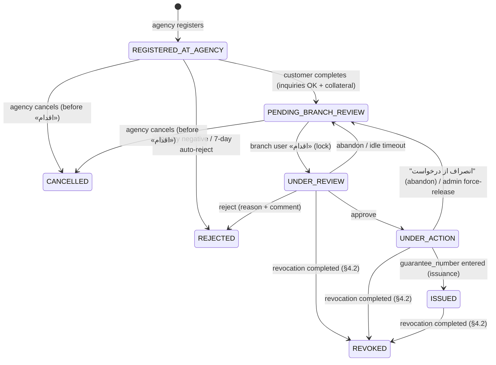
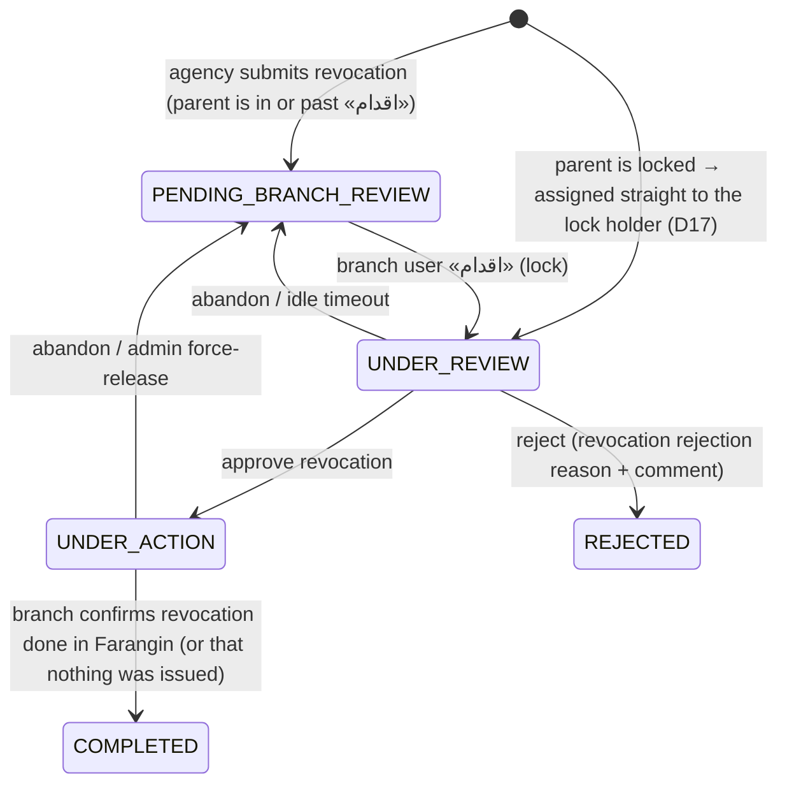

# AsanZeman (آسان ضمان) — Implementation Plan

> Sources:
> - *AsanZeman Architecture Document v1.0* (سند معماری سامانه آسان ضمان, 1405/08/07). Section references like **§3-3-4** point to this document.
> - *SRS-AZS v1.0* (1405/07/27). References look like **SRS: customer completion, step 13**.
>
> **Precedence:** where the two documents conflict, the **architecture document wins**. The SRS is used for business rules the architecture document doesn't spell out, such as the collateral formulas, eligible deposit types and screen behaviour.

---

## 1. What we are building

A system for a bank to process **travel-return guarantees** (ضمانتنامه بازگشت از سفر), from the agency's registration through branch approval to recording the guarantee number. Cancellation, revocation and reporting are included.

| Piece | Description |
|---|---|
| **Asan Zeman Core** | One Spring Boot **modular monolith** (Java 25, Spring Boot 4.1, virtual threads; see D9, D24) inside the bank intranet. It has 6 modules: Auth, Request, Inquiry, Notification, Report and Scheduler. |
| **Bank panel** | Angular SPA for branch users and admins (one app, role-based). Intranet only. Login: AAAService + ARcaptcha. |
| **Agency panel** | Angular SPA in the DMZ at `www.asanzeman.sb24.com/agencies`. Login: Yaghut `loginStatic` + ARcaptcha. |
| **Customer panel** | Angular SPA in the DMZ at `www.asanzeman.sb24.com`. Login: Yaghut `loginStatic` + ARcaptcha + SMS OTP. |
| **Oracle 19c+** | The **only** data store. There is no Redis, Kafka or object storage. Schemas: `AZS_AUTH`, `AZS_BUSINESS`, `AZS_INQUIRY`, `AZS_AUDIT`, `AZS_OUTBOX`. |
| **External** | **Called directly:** AAAService and Yaghut (4 services). **Through the Bank API Gateway:** the 9 inquiries, with one OAuth2 client-credentials token (D28, §5.2). **ARcaptcha and SMS Notifier** use their own authentication (documents pending). |
| **Out of scope (manual)** | Farangin (guarantee issuance and revocation) and the Digital Signature system. There is **no API integration** with either one. The branch user does this work by hand while the request is in `UNDER_ACTION`. |

### Core flows (§2-4)
1. **Issuance:** The agency registers the request. The customer completes it: the 9 inquiries run in two stages (Sabte Ahval first, then the other 8 in parallel; §5.1), and then the customer chooses collateral. The branch then locks the request and reviews it, and either approves (→ `UNDER_ACTION`) or rejects it. After approval, the branch signs and issues manually outside the system, then enters the guarantee number (→ `ISSUED`) and an SMS goes out.
2. **Cancellation or revocation by the agency.** What happens depends on how far the request has got (§4.2):
   - **Before «اقدام»** (`REGISTERED_AT_AGENCY` or `PENDING_BRANCH_REVIEW`): nothing has been done in the Digital Signature system or Farangin yet, so the request goes straight to **`CANCELLED` (لغو شده)**. No branch review is needed.
   - **From «اقدام» onward** (`UNDER_REVIEW`, `UNDER_ACTION` or `ISSUED`): something may already have been signed or issued, so a **revocation request (درخواست ابطال)** is sent to the branch. The branch reviews it, revokes manually in Farangin where needed, and confirms (→ **`REVOKED` (ابطال شده)**). The branch can also reject the revocation request.
3. **Agency tracking:** Filtered list of the agency's requests, with Excel export.
4. **Bank reporting:** Advanced filters with Excel export (SXSSF streaming).

---

## 2. Decision log

The architecture document contradicts itself, or is silent, on the points below. They were reviewed with the product owner on 1405/08/17 and 1405/08/19. ✅ means decided, ⏳ means open or proposed. Where the product owner had no preference, the recommended default was adopted. Every value marked *configurable* lives in `application.yml` and can change without a release.

**Still open:** D25 (structured concurrency, to be decided later) and D27 (the time budget, proposed).

| # | Topic | Decision | Details |
|---|---|---|---|
| D1 | ✅ Locking across the manual work | **Ownership lock** (`locked_by` on the request), with `SELECT … FOR UPDATE NOWAIT` guarding each change to it. ADR-003 is amended. | §4.1 |
| D2 | ✅ Customer mobile number (**revised** 1405/08/17) | **Stored in plain text**, together with the other customer details, when the agency registers the request (see D21). This replaces the earlier rule "never stored, fetched from Yaghut each time". | §6.1 |
| D3 | ✅ Inquiry technical failure | **Block and let the customer retry.** A *negative* answer rejects the request. A *technical* failure (timeout, 5xx, circuit open, unreadable response) blocks completion without rejecting. On retry, only the failed inquiries are re-run. A passed result is reused for **1 hour** (*configurable*). Manual-review fallback is **not** built. | §5.1 |
| D4 | ✅ Inquiry timeouts and retries | Use the **per-service table in §7-3** (8–15 s, 1–2 retries), not the flat 30 s with 3 retries. The whole run must stay within the **25 s budget** (P99, §9-1). All *configurable*. | §5, §5.1 |
| D5 | ✅ Session lifetime | Access token **15 min** for everyone. Refresh token **8 h** for branch, admin and agency users. **Customers:** a single **30-minute** session with no refresh token. All *configurable*. | §6 |
| D6 | ✅ Collateral formulas | Taken from the SRS. | §4.3 |
| D7 | ✅ Where the browser keeps tokens | **No cookies** (an infrastructure restriction). Both tokens are sent only as `Authorization: Bearer`, so **no CSRF protection is needed**. Access token **in memory**. Staff and agency refresh token in **`sessionStorage`**, with **rotation and reuse detection**. Customers: **memory only**, with no refresh token. Nothing in `localStorage`. | §6 |
| D8 | ✅ CI/CD | **GitHub Actions** while the code is on GitHub. The stages mirror §8-2, so the pipeline moves cleanly to GitLab CI later. | §7 Phase 0 |
| D9 | ✅ Versions (**revised** 1405/08/19) | **Java 25 (LTS), Spring Boot 4.1.x, Spring Modulith 2.1.x, Angular 22 with Nx.** Versions are pinned in the build. This replaces Boot 3.2, Java 17 and Angular 17 from §1-4, which are past upstream support. Java 25 was chosen over 21 because, since Java 24, virtual threads no longer pin their carrier thread inside `synchronized` blocks (D24). | §3 |
| D10 | ✅ Runtime | **Build a Docker image (executable jar) now.** Keep a Tomcat/WAR profile possible. Decide Kubernetes versus VMs with the ops team before Phase 10. | §7 Phase 10 |
| D11 | ✅ Cancellation versus revocation | **Before «اقدام»:** the request goes to `CANCELLED` (لغو شده) immediately. **From «اقدام» onward**, including approved and issued requests: a revocation request goes to the branch and ends in `REVOKED` (ابطال شده). | §4.2 |
| D12 | ✅ Tracking code | 17 digits: branch (3) + agency (4) + date YYMMDD (6) + a 4-digit counter. The counter runs **per branch + agency + day**, in a `tracking_counter` table incremented under a row lock. | §4 |
| D13 | ✅ Secret store | **Not known yet.** The app reads secrets from **environment variables or mounted files**, so Vault, Kubernetes Secrets or encrypted files can be added later without code changes. Locally, a key file is used. | §6 |
| D14 | ✅ Pledge formula | **Follow the SRS worked example:** pledge = `(amount − cash) × factor`. For example, 1,000,000,000 rials with 20 % cash pledges 800,000,000 (840,000,000 on expensive deposits). The literal SRS formula, which gives 640,000,000, is treated as a typo. | §4.3 |
| D15 | ✅ Mixed cheap and expensive pledge | **Cheap deposits are filled first** (×1.00), then expensive ones (×1.05, each capped at 95 % of its balance). Within each group, deposits are filled in the order the customer selected them. | §4.3 |
| D16 | ✅ Balance changes before approval | **Balances are re-checked** through Yaghut `getDeposit` when the branch clicks approve. If the deposits no longer cover the collateral, approval is blocked and the shortfall is shown. | §4.3, Phase 4 |
| D17 | ✅ Revocation while the branch is mid-work | **Issuance actions stop**, except for recording a guarantee number that was *already* issued in Farangin. The revocation request goes **straight to the user who holds the lock**. An admin can reassign it with force-release. | §4.2 |
| D18 | ✅ Rounding | Collateral amounts are **rounded up to the whole rial** (`BigDecimal`, `CEILING`), so the bank is never under-covered. | §4.3 |
| D19 | ✅ Guarantee expiry | **There is no `EXPIRED` status, and no job changes issued guarantees.** Asan Zeman has no connection to Farangin, where the guarantee actually lives, so it can't know when one really ends. `expiry_date` is stored as information only (shown in tracking and reports, and usable as a filter). An `ISSUED` request can be revoked at any time. | §4.2 |
| D20 | ✅ Database migrations | **Flyway replaces Liquibase** (§5-4). Versioned SQL migrations, **forward-fix only**, because Flyway undo is a paid feature. A risky change gets a hand-written undo script for the DBA. | §4, Phase 0 |
| D21 | ✅ Customer data snapshot | When the agency registers a request, Yaghut `getCustomerDetailInfo` is called **once**. The mobile number and the other details are saved **in plain text** and used for **the whole life of the request** (Shahkar, OTP, SMS, display). They are never refreshed from Yaghut or `loginStatic`. **Exception:** gender and birth date for the inquiries come from Sabte Ahval, because Yaghut's gender is unreliable (D26). | §6.1 |
| D22 | ✅ No masking | **Nothing is masked anywhere**: screens, Excel exports, logs, the audit log, error messages and saved raw responses. The masking code stays behind `azs.privacy.masking-enabled: false`, so it can be switched on later without a code change. | §6 |
| D23 | ✅ No rate limiting or bulkheads | **No rate limits** (neither the 100 requests/min per-IP filter from §6, nor the 10 requests/s limiter on outgoing calls) and **no semaphores or bulkheads** on external services. What remains: per-service timeouts and retries, circuit breakers, ARcaptcha, and the OTP lockout. | §5, §6 |
| D24 | ✅ Virtual threads | `spring.threads.virtual.enabled=true`, so incoming HTTP requests, inquiry runs, `@Async` work and scheduled jobs all run on virtual threads. The **Hikari connection pool** is the only limit on database work, and inquiry runs never hold a DB connection while waiting on a service. | §5.1 |
| D25 | ⏳ **Open:** structured concurrency | Java 25's `StructuredTaskScope` would suit each inquiry stage, but it is still a **preview** feature. The product owner will decide later. **Working default:** `CompletableFuture` on virtual threads. Only `StageRunner` would change if we switch. | §5.1 |
| D26 | ✅ Inquiry order: two stages | **Stage 1: Sabte Ahval alone.** It supplies the authoritative gender and birth date. **Stage 2: the other 8 in parallel.** Sepad runs only for men aged 18–50 *inclusive*, using Sabte Ahval's data. Implemented as **one chain of stages** (Chain of Responsibility), with **one Strategy class per inquiry**. The stage list is configurable. | §5.1 |
| D27 | ⏳ **Proposed:** time budget | §7-3's timeouts × attempts can't fit the 25 s budget (Sabte Ahval alone is 15 s × 3 = 45 s). **Proposal: deadline-aware retries.** Each stage gets a deadline (stage 1: **10 s**, stage 2: **15 s**, both configurable). A retry starts **only if the time left in the stage is at least that service's timeout**; otherwise the inquiry is `FAILED`, and the customer can retry (D3). *Needs product-owner confirmation.* | §5.1 |
| D28 | ✅ Gateway token | OAuth2 **client credentials** from `apigw.int.sb2.com/ApiContainer.sso.RCL1/connect/token`. One token per app instance, kept in memory and refreshed before its 2-hour expiry. It is used by **the 9 inquiries only**; ARcaptcha and Notifier have their own authentication. `invalid_client` (HTTP 400) is a configuration error and is not retried. | §5.2 |
| D29 | ✅ Rejection messages | Taken **from the SRS** for every inquiry. The exception is Sabte Ahval `300` (wrong details), which uses the product owner's text because the SRS has none. All messages live in a message config file. | §5.3 |

The original issue descriptions are in this file's git history (commit `d2c7498`).

---

## 3. Repository layout

```
asanzeman/
├── plan.md                      ← this file
├── docs/
│   ├── architecture/            ← source doc + diagrams, ADRs (one md per ADR)
│   └── api/openapi.yaml         ← API-first contract (§1-3)
├── backend/                     ← Spring Boot modular monolith (Maven)
│   └── src/main/java/com/sb24/asanzeman/
│       ├── AsanZemanApplication.java
│       ├── shared/              ← BaseEntity, errors, idempotency, audit, security utils
│       ├── auth/                ← api/ (public interfaces) + internal/
│       ├── request/             ← domain/, api/, internal/ (RequestService, CollateralService, LockService)
│       ├── inquiry/
│       ├── notification/
│       ├── report/
│       ├── scheduler/
│       └── integration/         ← AAAClient, YaghutClient, GatewayTokenProvider, one client per inquiry (+ fakes)
│   └── src/main/resources/db/migration/   ← Flyway SQL migrations (D20)
├── frontend/                    ← Nx monorepo (ADR-007)
│   ├── apps/bank-panel/
│   ├── apps/agency-panel/
│   ├── apps/customer-panel/
│   └── libs/ (ui-rtl, auth, api-client generated from OpenAPI, shared models)
├── deploy/                      ← Dockerfiles, docker-compose (Oracle XE + mocks), k8s manifests
└── .github/workflows/           ← CI (see D8)
```

**Module boundaries:** use **Spring Modulith**, plus an ArchUnit test, so that cross-module calls can only go through each module's `api` package (ADR-001). This check runs in CI and fails the build when broken.

---

## 4. Domain model and state machine

### Entities (§5-1)
`Customer`, `Agency`, `Branch`, `Request`, `Companion` (≤ 5 per request), `Collateral`, `Inquiry`, `RejectionReason` and `AuditLog`. All of them extend `BaseEntity`, which has `id RAW(16)` (SYS_GUID), `created_at`, `updated_at`, `created_by` and `updated_by`.

Supporting tables: `otp_codes`, `refresh_tokens`, `jwt_blacklist`, `outbox_messages`, `scheduler_lock`, `idempotency_keys`, `tracking_counter`.

### Request lifecycle (§4-3-1, §7-5)

**Issuance request** (`request_type = ISSUANCE`):



**Revocation request** (`request_type = REVOCATION`, linked to its issuance request by `parent_request_id`). It goes through the same branch review and lock process as an issuance request:



| Status | Persian label | Meaning |
|---|---|---|
| `CANCELLED` | لغو شده | The agency withdrew the request **before «اقدام»**. Nothing was done outside the system. |
| `REVOKED` | ابطال شده | The issuance request was revoked through an approved and completed revocation request. |
| `PENDING_BRANCH_REVIEW` (on a revocation) | در انتظار بررسی درخواست ابطال ضمانتنامه | Waiting in the branch inbox (SRS UC-11, step 6) |

> **Naming.** The architecture document uses `CANCELLED` and `request_type = CANCELLATION` for ابطال. This plan separates **لغو (`CANCELLED`)** from **ابطال (`REVOKED`, `REVOCATION`)**, as the product owner asked. The meaning is unchanged; only the names differ.

- Transitions are implemented as methods on `Request`:
  - issuance: `complete()`, `cancelByAgency()`, `markIssued()`, `markRevoked()`
  - both request types: `lock()`, `approve()`, `reject()`, `abandon()`

  An illegal transition throws an `IllegalStateException`, which the API returns as **409**.
- Every transition publishes a Spring `ApplicationEvent` (`RequestRegistered`, `RequestCancelled`, `RevocationRequested`, `RequestApproved`, `RequestRejected`, `RequestRevoked`, `AutoRejectTriggered`, …). Notification and Audit subscribe to these events with `@TransactionalEventListener(AFTER_COMMIT)` (or `BEFORE_COMMIT` when writing to the outbox).

### 4.1 Request locking (resolves D1, amends ADR-003)

**The problem.** A database row lock from `SELECT … FOR UPDATE NOWAIT` is released at the end of its transaction, so it can't last longer than one HTTP request. The SRS says that once a branch user clicks **«اقدام»** (take action), the request is locked and disappears from every other user's inbox. It stays that way until the user finishes, or clicks **«انصراف از درخواست»** (abandon). That covers the whole `UNDER_REVIEW` and `UNDER_ACTION` period, including the manual digital-signature and Farangin steps, which can take hours.

**The design.** The lock is two layers working together:

1. **Ownership lock (lasts across requests).** It is stored as columns on `request`:
   - `locked_by` (RAW(16), the branch user), `locked_by_name` (for the inbox label), `locked_at` and `last_activity_at`
   - `version` (NUMBER, JPA `@Version`), as a second safeguard

   A request is locked whenever `locked_by IS NOT NULL`. The status says which phase it is in: `UNDER_REVIEW` or `UNDER_ACTION`.

2. **Row lock (lasts one transaction).** **Every** command that reads or changes ownership runs inside a single short transaction:
   ```
   BEGIN
     SELECT … FROM request WHERE id = :id FOR UPDATE NOWAIT   -- @Lock(PESSIMISTIC_WRITE) + lock.timeout=0
     -- ORA-00054 → 409 "این درخواست در حال اقدام توسط کاربر دیگری است" (another user is acting on this request)
     check branch scope, current status, and ownership
     apply the transition, write the audit row, publish the domain event
   COMMIT                                                     -- row lock released immediately
   ```
   This makes taking ownership atomic. Two users clicking «اقدام» at the same moment can't both win: one gets the row lock, and the other gets ORA-00054, which becomes a 409.

| Command | Allowed when | Effect |
|---|---|---|
| `POST /api/branch/requests/{id}/lock` («اقدام») | `PENDING_BRANCH_REVIEW` and request belongs to the user's branch, **or** the user already holds it (idempotent re-entry) | `UNDER_REVIEW`, sets `locked_by`, `locked_at` and `last_activity_at` |
| `approve` | `UNDER_REVIEW` and `locked_by = me` | `UNDER_ACTION`. **Ownership is kept** through the manual signing and Farangin steps |
| `reject` | `UNDER_REVIEW` and `locked_by = me` | `REJECTED`, clears the lock |
| `issue` (enter guarantee number) / `complete-revocation` | `UNDER_ACTION` and `locked_by = me` | Issuance request → `ISSUED`. Revocation request → `COMPLETED`, and its issuance request → `REVOKED`. Clears the lock. |
| `abandon` («انصراف از درخواست») | `UNDER_REVIEW` or `UNDER_ACTION`, and `locked_by = me` | `PENDING_BRANCH_REVIEW`, clears the lock |
| `force-release` (ADMIN only, reason required) | locked by anyone | `PENDING_BRANCH_REVIEW`, clears the lock, **audited** |
| any other mutating call while `locked_by ≠ me` | — | **409**, with the holder's name and the time it was locked |

- **Inbox (SRS):** locked requests are removed from other users' *action* lists but stay **visible read-only**, labelled "در حال بررسی / در حال اقدام — {name}". All branch users can still open the details.
- **Stale locks.** ADR-003 says the lock is freed if the user's session crashes, but an ownership lock doesn't free itself. So:
  - **`UNDER_REVIEW`:** a scheduler job releases locks idle longer than `azs.lock.review-idle-timeout` (default **60 min**, configurable) back to `PENDING_BRANCH_REVIEW`. This is audited as `AUTO_RELEASE`.
  - **`UNDER_ACTION`:** **never** released automatically, because the user may be partway through Farangin. It is freed only by the holder (abandon or complete) or by an admin force-release.
- **Every lock event is audited:** LOCK, ABANDON, AUTO_RELEASE and FORCE_RELEASE, with who did it, when, the IP and the reason.
- **Tests (Phase 4):** concurrent lock attempts (exactly one wins and the other gets 409); a non-owner trying approve, reject or issue (409); idempotent re-lock by the owner; auto-release of `UNDER_REVIEW` only; admin force-release; the lock surviving between HTTP calls.

### 4.2 Agency cancellation versus revocation (resolves D11)

**The rule (from the product owner).** Clicking «اقدام» is the dividing line:
- **Before «اقدام»**, the branch hasn't touched the Digital Signature system or Farangin, so the agency can simply **cancel (لغو)**.
- **From «اقدام» onward**, a contract may have been signed or a guarantee issued outside the system, so the branch must **revoke (ابطال)** it.

**One action, two outcomes.** The agency panel has a single «ثبت درخواست ابطال» (submit revocation request) action. The backend decides the outcome inside one transaction, under the row lock from §4.1:

```
BEGIN
  SELECT … FROM request WHERE id = :id FOR UPDATE NOWAIT     -- same guard as §4.1
  check agency ownership
  CASE status
    REGISTERED_AT_AGENCY, PENDING_BRANCH_REVIEW        → status = CANCELLED                       (لغو)
    UNDER_REVIEW, UNDER_ACTION, ISSUED                 → create REVOCATION request (parent_request_id)  (ابطال)
    REJECTED, CANCELLED, REVOKED                       → 409 (nothing to cancel)
    a revocation is already open                       → 409 (duplicate)
COMMIT
```

- **The confirmation message the agency sees depends on the status.** Before «اقدام», it says the request will be cancelled immediately. From «اقدام» onward, it uses the SRS text: «… پس از تایید، درخواست برای شعبه مربوطه ارسال خواهد شد» (after confirmation, the request will be sent to the branch). The API response also says which outcome happened (`CANCELLED` or `REVOCATION_REQUESTED`).
- **Race with the branch.** Suppose the agency clicks cancel at the same moment a branch user clicks «اقدام». The row lock lets only one of them go first. If the branch wins, the agency's call sees `UNDER_REVIEW` and creates a revocation request instead, which is the correct outcome. If the agency wins, the request is cancelled, and the branch user's «اقدام» gets a 409.
- **When the issuance request is mid-work (D17).** If it is in `UNDER_REVIEW` or `UNDER_ACTION`:
  - approve and reject on the issuance request are disabled
  - the holder may still record a guarantee number that was *already* issued in Farangin, so the records match reality
  - the new revocation request is assigned directly to that holder, with its status set to `UNDER_REVIEW` and its `locked_by` set to the holder
- **When revocation completes:** the issuance request moves to `REVOKED`, an audit row is written, and the customer and agency receive an SMS. If nothing had actually been issued in Farangin, the branch confirms that instead, and the issuance request still ends as `REVOKED`.
- **When revocation is rejected:** the revocation request becomes `REJECTED`, with a reason from the admin-managed list of revocation rejection reasons (SRS use case 6) and a comment. The issuance request is unchanged. If it was mid-work, its normal flow resumes.
- **No expiry (D19).** Asan Zeman never changes an `ISSUED` request because of its `expiry_date`, since the real guarantee lives in Farangin. An `ISSUED` request can be revoked at any time. `expiry_date` is shown, and can be filtered on, in tracking and reports.
- **Reports and tracking** show `CANCELLED` and `REVOKED` as separate statuses. Both the agency and the bank panels can filter on each.
- **Tests (Phase 5):**
  - every source status gives the correct outcome, as in the table above
  - the cancel-versus-«اقدام» race
  - a duplicate revocation returns 409
  - revocation of a request that is mid-work goes straight to the lock holder
  - a rejected revocation leaves the issuance request unchanged

### 4.3 Collateral calculation (resolves D6; source: SRS customer completion, steps 8–13 and the calculation table)

**Two kinds of collateral**
- **Cash (وجه نقد):** money is **withdrawn** from the customer's deposits.
- **Deposit pledge (توثیق سپرده):** money is **blocked** in the customer's deposits.

**Deposits shown to the customer** come from Yaghut `getDeposit`, filtered in the backend. A deposit is shown only if it is:
- held individually (انفرادی), not joint, with the customer as owner **and** signatory
- open and active, and not blocked for debit or credit (مسدود بدهکار/بستانکار)
- in rials. Foreign-currency deposits are never shown.

| Deposit type | Price class | Allowed for cash | Allowed for pledge |
|---|---|---|---|
| Short-term normal (کوتاه‌مدت عادی) | Cheap | ✅ | ✅ |
| Short-term Win (کوتاه‌مدت وین) | Cheap | ✅ | ✅ |
| Qard-al-Hasan savings (قرض‌الحسنه پس‌انداز) | Cheap | ✅ | ✅ |
| Qard-al-Hasan savings Win (قرض‌الحسنه پس‌انداز وین) | Cheap | ✅ | ✅ |
| Qard-al-Hasan current (قرض‌الحسنه جاری) | Cheap | ✅ | ✅ |
| Long-term (بلندمدت) | Expensive | ❌ | ✅ (block ≤ 95 % of balance) |
| Short-term special (کوتاه‌مدت ویژه) | Expensive | ❌ | ✅ (block ≤ 95 % of balance) |

> The SRS table row for cash lists fewer types than its own deposit-filter rules. This plan follows the **filter rules**, which give the full list above. The mapping from Yaghut deposit type codes to price class goes in a reference table, so it can change without a release.

**Share percentages (SRS step 12)**
- Cash share `c`: 20 % to 100 %, in steps of 10. **At least 20 % cash is mandatory.**
- Pledge share `p`: 0 %, or 10 % to 80 %, in steps of 10.
- `c + p = 100 %`. If `c = 100 %`, the pledge options are disabled.
- A deposit can be marked for cash, pledge or both, and more than one deposit can be selected.

**Formulas.** `A` is the guarantee amount in rials.

| Part | Amount | Rule that must hold |
|---|---|---|
| Cash | `C = c × A` | Σ withdrawable balance of the deposits selected for cash ≥ `C` |
| Pledge base | `R = A − C` (= `p × A`) | — |
| Pledge on cheap deposits | `R_cheap × 1.00` | Σ withdrawable balance of the selected cheap deposits ≥ the amount blocked on them |
| Pledge on expensive deposits | `R_exp × 1.05` | For **each** expensive deposit, the amount blocked ≤ **95 %** of its withdrawable balance. If not, show an error and ask the customer to pick another option. |
| **Total collateral** | `C + R_cheap × 1.00 + R_exp × 1.05` | `R_cheap + R_exp = R`, split per D15 |

- When one deposit is used for both cash and pledge, the cash withdrawn plus the amount blocked must fit within that deposit's withdrawable balance.
- **Rounding:** use `BigDecimal` and round to whole rials with `CEILING`, so the bank is never under-collateralised (D18).
- **Insufficient balance (SRS sub-flow 11):** show «مشتری گرامی! به دلیل کافی‌نبودن موجودی در سپرده‌های انتخابی برای وثیقه، ثبت درخواست امکان‌پذیر نیست…» (insufficient balance in the selected deposits). The request cannot be submitted.
- **UI:** show a green tick next to each deposit row once the selection covers the required amount. When cash alone is enough at 100 %, the other rows are disabled.

**Worked examples.** These become unit tests. `A = 1,000,000,000` rials.

| Case | Cash | Pledge | Total collateral | Notes |
|---|---|---|---|---|
| 100 % cash | 1,000,000,000 | 0 | 1,000,000,000 | pledge rows disabled |
| 20 % cash, 80 % cheap pledge | 200,000,000 | 800,000,000 | 1,000,000,000 | SRS example (D14) |
| 20 % cash, 80 % expensive pledge | 200,000,000 | 840,000,000 | 1,040,000,000 | SRS example; that deposit's balance must be ≥ 884,210,527 (840M ÷ 0.95, rounded up) |
| 50 % cash, 50 % expensive pledge | 500,000,000 | 525,000,000 | 1,025,000,000 | |
| 10 % cash | — | — | — | rejected, below the 20 % minimum |
| 20 % cash, 70 % pledge | — | — | — | rejected, shares must add up to 100 % |

**Implementation.** `CollateralService` uses the Strategy pattern from §4-3-2, with these strategies:
- `CashStrategy`
- `CheapPledgeStrategy` (factor 1.00)
- `ExpensivePledgeStrategy` (factor 1.05, cap 0.95)

Each strategy is an immutable value class. The factors, the cap and the share ranges live in configuration.

**What gets saved:** one `Collateral` row per deposit allocation, with:
- deposit number and type, price class, collateral type (CASH or PLEDGE)
- share %, factor, allocated amount and calculated collateral

**Balances are never saved** (§6-3-1). They are fetched again at branch approval (D16).

---

## 5. Integration plan (§4-5, §7)

| Client | Target | Notes |
|---|---|---|
| `AAAClient` | AAAService (direct HTTPS) | Login for branch/admin users. Returns the user and their role (`ROLE_BRANCH` or `ROLE_ADMIN`) and the branch code. |
| `YaghutClient` | Yaghut (direct HTTPS) | Four calls: `loginStatic`, `getBranch`, `getDeposit` and `getCustomerDetailInfo`. Deposit data is **never stored**. |
| `GatewayTokenProvider` | `apigw.int.sb2.com` (token endpoint) | OAuth2 client credentials (D28). The token is added to **the 9 inquiry clients only** (§5.2). |
| 9 inquiry clients | `apigw.int.sb24.com` / `apigw3p.int.sb24.com` | One client per inquiry, with its own host, path and request fields in config (§5.3). |
| `ArcaptchaClient`, `NotifierClient` | — | Their own authentication. **Documents pending.** |

- **Anti-corruption layer:** each external service gets its own adapter that maps its format to domain types.
- **Resilience4j** (§7-6): circuit breaker opens at 50 % failures over a 20-call window and stays open 30 s. Timeouts and retries per service, from the §7-3 table (8–15 s, 1–2 retries with exponential backoff, on 5xx and timeouts only; D4), with retries limited by the stage deadline (D27). **No bulkheads or rate limiters** (D23). All values are configurable per client.
- Every call sends an `Idempotency-Key` header and the correlation/trace ID.
- **Mocks: two layers**, built from the bank's service documents, one service at a time:
  - **WireMock server (main layer):** runs in docker-compose and answers exactly like the real service (URLs, headers, JSON or SOAP, error codes). The app's **real** client code calls it, so serialisation, auth, timeouts and retries are all exercised. It's also used in integration tests.
  - **In-app fakes:** Java implementations of the same client interfaces, under the `fake` profile, for fast unit tests and frontend work with no server.
- **What each service gets:**
  - a contract summary in `docs/integrations/<service>.md`, which includes the classification of every result code as business-negative or technical (it drives D3)
  - a client interface with DTOs and an adapter (the anti-corruption layer)
  - WireMock stubs for the happy path, each business negative, and the technical failures: delay past the timeout, 5xx, a malformed body, a dropped connection, and "fails then recovers" using WireMock scenarios
  - client tests
- **Test personas:** the national code picks the scenario (for example, `0000000001` means all OK, `0000000002` means deceased, `0000000009` means Sepad times out once and then succeeds), so any case can be reproduced without changing config. A persona table goes in `docs/integrations/personas.md`.
- **Only synthetic data** goes in stubs and in the repo. Any real customer data in the bank's documents is replaced before it is committed.
- **Order:**
  1. Gateway token, ARcaptcha and Notifier (Phase 1)
  2. AAAService and Yaghut `loginStatic`
  3. Yaghut `getCustomerDetailInfo`, `getBranch` and `getDeposit`
  4. the 9 inquiries

### 5.1 Running the customer inquiries (UC-09, resolves D3 and D4)

**Every inquiry result falls into one of four groups:**

| Result | Meaning | Examples |
|---|---|---|
| `PASSED` | The service answered, and the answer is OK | alive, Shahkar matches, no bounced cheques |
| `NEGATIVE` | The service answered, and the answer disqualifies the customer | deceased, military-service status not allowed, bounced cheque |
| `FAILED` | **No usable answer** after the automatic retries | timeout, 5xx error, connection refused, circuit breaker open, response that can't be read |
| `SKIPPED` | The inquiry doesn't apply to this customer | Sepad for women, or men outside ages 18–50 |

A result is only `NEGATIVE` when the service clearly says so. Anything unclear counts as `FAILED`, so nobody is rejected because of a technical fault.

**How the results are combined**
- Any `NEGATIVE` → **reject** with the SRS message for that inquiry. The inquiries still running are cancelled.
- No `NEGATIVE`, but at least one `FAILED` → **blocked**. The request stays in `REGISTERED_AT_AGENCY`; nothing is rejected and no SMS is sent. The customer sees:
  «مشتری گرامی! در حال حاضر امکان انجام برخی استعلام‌ها وجود ندارد. لطفاً دقایقی دیگر مجدداً تلاش کنید.» ("some inquiries can't be done right now, please try again in a few minutes")
- Everything `PASSED` or `SKIPPED` → the customer goes on to choose collateral (§4.3).

**How a run works**
- **It runs in the background.** `POST /api/customer/requests/{id}/inquiries` starts a run and returns **202** with a `runId`. The panel polls `GET …/inquiries/{runId}`, or uses server-sent events, and shows each of the 9 inquiries live (✓, ✗ or ⟳). A slow service therefore can't push the page past the proxy's HTTP timeout.
- **Two stages, run as one chain (D26):**
  ```
  Stage 1: [SABT_AHVAL]                      → NEGATIVE: reject · FAILED: blocked · PASSED: continue
                                               (gender + birth date go into the InquiryContext)
  Stage 2: [SHAHKAR, SEPAD, BLACKLIST, SAMA_CHEQUE, SAMAT, BOARD_RELATION,
            IMPORT_COMMITMENT, EXPORT_COMMITMENT]  (in parallel)
                                             → any NEGATIVE: reject (cancels the rest)
                                             → any FAILED: blocked · all PASSED/SKIPPED: collateral
  ```
  - Each inquiry is an `InquiryHandler` strategy with `type()`, `appliesTo(ctx)` (Sepad: male and aged 18–50 inclusive, from Sabte Ahval) and `execute(ctx)`.
  - A stage's handlers run in parallel. A stage with a single handler behaves like a classic chain link.
  - The stage list lives in config (`azs.inquiry.stages`), so a stage can be added without code changes.
  - If Sabte Ahval is `FAILED`, stage 2 doesn't run.
- **Threads:** virtual threads (D24), via `Executors.newVirtualThreadPerTaskExecutor()` and `CompletableFuture`. Whether to use `StructuredTaskScope` is still open (D25). The first `NEGATIVE` calls `cancel(true)` on the rest, and the HTTP client (`RestClient` on the JDK `HttpClient`) reacts to the interrupt. The correlation ID is carried into the virtual threads with Micrometer context propagation.
- **Time:** stage 1 then stage 2, each with its own deadline (D27). Different customers' runs are independent and run side by side.
- **Each service has its own timeout and retries** (§7-3 table, D4), applied by Resilience4j inside the client. An inquiry is marked `FAILED` only after its retries are used up. When a circuit breaker is open, the inquiry fails at once, without waiting for the timeout.
- **One run per request at a time.** The row lock (§4.1) is held for milliseconds, only to record "a run has started". If the customer double-clicks or opens a second tab, the call **attaches to the run already in progress** and returns its `runId`, so the customer never sees an error. A run older than `azs.inquiry.run-stale-after` (default **60 s**) is treated as dead (for example, after a server restart), and a new one may start.

**Retry by the customer**
- A «تلاش مجدد» (try again) button appears, with a cooldown of `azs.inquiry.retry-cooldown` (default **60 s**).
- On retry, **only the `FAILED` inquiries, and any whose result has gone stale, are re-run**. A `PASSED` result is reused for `azs.inquiry.result-reuse-window` (default **1 hour**).
- The 7-day auto-reject still applies. If a service stays down for a week, the request is auto-rejected under the existing rule.

**What is saved:** one `inquiry` row per inquiry per attempt, with:
- `run_id`, `inquiry_type`, `attempt_no`, `result` and `failure_kind` (`TIMEOUT`, `UNAVAILABLE`, `CIRCUIT_OPEN` or `BAD_RESPONSE`)
- the provider's response code, `duration_ms`, start and finish times, the provider's tracking ID (`conversationId`, `trackingCode`, `requestId`, …), and the full raw response (no masking, D22)

**Monitoring:** a Micrometer counter and timer per inquiry type and result, plus an alert when an inquiry type's `FAILED` rate is above a threshold. Ops then hears about an outage before customers complain.

**Tests (Phase 3):**
- every combination of `NEGATIVE`, `FAILED` and `PASSED`
- a double-click attaches to the running run
- a retry re-runs only the failed and stale inquiries
- the cooldown is enforced
- a stale run is recovered
- an open circuit fails fast
- a full run stays inside the stage deadlines with injected latency, and retries stop at the deadline (D27)
- stage 2 doesn't run when Sabte Ahval fails, and Sepad is `SKIPPED` for women and for men outside 18–50 (the boundaries 18 and 50 are included)

### 5.2 Gateway token (D28)

- **Request:** `POST https://apigw.int.sb2.com/ApiContainer.sso.RCL1/connect/token`, with a form body of `grant_type=client_credentials`, `client_id` and `client_secret`.
  - The Postman headers in the bank's sample (`Postman-Token`, `User-Agent`, the `BIGipServer` load-balancer cookies, …) are **not** sent.
- **Response:** `access_token`, `expires_in: 7200`, `token_type: Bearer` and `scope`.
  - The error case is HTTP **400** with `{"error":"invalid_client"}`.
- **Implementation:** Spring Security's OAuth2 client (`spring.security.oauth2.client.registration.bank-gateway`), plus a `RestClient` interceptor that adds `Authorization: Bearer …` to the inquiry clients only.
  - The token is cached in memory and refreshed about 5 minutes before it expires.
  - When many calls need a token at once, only one token request is sent.
  - A 401 from an inquiry clears the cached token, fetches a new one once, and retries the call.
- **Errors:**
  - `invalid_client` → not retried. The waiting inquiries become `FAILED` and ops gets an alert.
  - 5xx, a timeout or a dropped connection → 2 retries with backoff, then `FAILED`.
- **Secrets:** `client_id` and `client_secret` come only from the environment or the secret store (D13). The values shared during the design review should be **rotated** before go-live.
- **Mock personas:**
  - `test-client`: success
  - `test-short-ttl`: `expires_in: 60`
  - wrong credentials: `invalid_client`
  - `503`, then `200`
  - a slow answer and a malformed body
  - all the inquiry stubs require `Bearer mock-gw-…` and return 401 without it

### 5.3 Inquiry catalogue (from the bank's service documents)

**Shared rules for every inquiry**
- The fixed request fields (`ChanelCode`, `requestType`, `personType`, …) are **configurable** per inquiry. `branch-code: REQUEST` means "use the request's branch".
- Values are checked at startup, so a missing setting stops the app with a clear error.
- Any HTTP 4xx, 5xx, timeout, broken JSON or unknown value counts as `FAILED`. A 400 also raises an alert to the developers, since it means we sent something wrong.
- The **birth date** always comes from the Sabte Ahval result, formatted per service. One `JalaliDateFormatter` produces every format.

| # | Inquiry | Endpoint (POST, gateway token) | Request | `PASSED` | `NEGATIVE` (SRS message) | `FAILED` (beyond the shared rules) |
|---|---|---|---|---|---|---|
| 1 | **Sabte Ahval** (stage 1) | `apigw3p.int.sb24.com/ApiContainer.SBCivil.SabtREST/api/Civil/GetEstelamSabt` | `sabtParam {nationalCode, birthDate "yyyyMMdd", requestType}` + `clientTrackingParam {userName, ip, branchCode, chanelCode}` (all configurable) | `serviceStatus.statusField "200"` and `isaliveCode 0` | `isaliveCode 1` → «…به دلیل عدم امکان ارائه خدمات بانکی به شخص فوت‌شده…»; `statusField "300"` (`err.record.not.found`) → «اطلاعات هویتی مشتری صحیح نمی‌باشد» | `hasError: true` (any `errorCd`); any other `statusField` or `isaliveCode`. **Don't rely on `hasError`**: a mismatch still comes back with `hasError: false` |
| 2 | **Shahkar** | `apigw.int.sb24.com/ApiContainer.SBShahkar/api/ShahkarWrap/ServiceIdMatching` | `serviceNumber` (mobile), `identificationNo` (national code), `identificationType "0"`, `serviceType "2"`, `ClientTrackingparam {UserName, Ip, BranchCode, ChanelCode}` (**PascalCase**; type fields are strings) | `response 200` | `response 600` (`NotIdentifiedException`) → «…به دلیل عدم تطابق شماره تلفن همراه با کدملی… موبایلت ← پروفایل ← تنظیمات ← تغییر شماره تلفن همراه» | `response 311` (invalid national code) → alert. **`id` is always "200"; use `response`** |
| 3 | **Sepad** (men 18–50) | `apigw.int.sb24.com/ApiContainer.SBSepad.RCL1/api/Sepad/GetEstelam` | `nationalId`, `birthDate "yyyy/MM/dd"` (slashes) | `result "1"` (مجاز), **or** `result "0"` with «مشمولی با اطلاعات وارد شده یافت نشد» | `result "0"` with «غیرمجاز» → «…به دلیل عدم احراز وضعیت مجاز نظام وظیفه…» | `result "0"` with any other text; `errorCode`, `errorMessage` or `errorResult` set. The text is normalised (Arabic `ي`/`ك` → `ی`/`ک`, ZWNJ, spaces, a trailing `.`), and the known texts are in config. `expirationDate` is ignored |
| 4 | **Blacklist** | `apigw.int.sb24.com/ApiContainer.SBCustomerGroup/api/SBGetCstBlackList/GetCstBlackList` | `nationalKey` | `result: false` | `result: true` → «…به دلیل محدودیت‌های بانک مرکزی… لطفاً به آژانس هواپیمایی خود مراجعه کنید.» | `result` missing. **Inverted:** mapped to a Java field `onBlacklist` |
| 5 | **SamaCheque** (bounced cheques) | `apigw.int.sb24.com/ApiContainer.SBSamaCheque/api/CbiSamaCheque/GetBouncedChequesByPersonInfo` | `personInfo {nationalId, personType 1}`, `requestInfo "1"` | `isValid: true`, `cheques: []` | any cheque → «…به دلیل دارا بودن چک برگشتی…» | `isValid: false` (`chq402` national code → alert; `chq453` personType → alert; others); `cheques: null`. The cheque details are saved for the branch, and `serial` is trimmed |
| 6 | **Samat** (non-current loans) | `apigw.int.sb24.com/ApiContainer.SBSamatWrp/api/CbiSamat/GetEstelamAsli2` | `cstmrShenase` (national code), `cstmrType "1"`, `estlmId "1"` (all strings) | Σ over all loans, at every bank, of (`amSarResid` + `amMoavagh` + `amMashkuk`) **= 0**, including when there are no loans | that sum **> 0** → «…به دلیل دارا بودن بدهی (تسهیلات) غیرجاری…» | `hasError: true` (`errorCd "11"` national code → alert); `returnValue: null`. Amounts are `BigDecimal`. `amSukht`, `dasteBandi` and `badHesabiDate` are stored but don't affect the result |
| 7 | **BoardRelation** (credit limits) | `apigw.int.sb24.com/ApiContainer.SBCBIBoardRelation/api/SBQueryLimit/QueryLimit` | `amount` (the guarantee amount, in rials), `customerType 1`, `nationalIdOrLegalId`, `birthDateOrRegisterDate "yyyyMMdd"` | `result: true` | `result: false` → «…به دلیل محدودیت‌های بانک مرکزی… لطفاً به آژانس هواپیمایی خود مراجعه کنید.» The service's `description` (which limit was broken) is saved for the branch | `result` missing; HTTP 400 → alert |
| 8 | **ImportCommitment** (varedati) | `apigw.int.sb24.com/ApiContainer.SBRafTaahodArzi.RCL1/api/RafeTaahodArzi/GetTaahodArziRafNashodeh` | header `ChanelCode: 15`; body `shenasehMelliOrShomarehKartBazargani` (the 10-digit national code) | `returnData` has items, all with `izMojaz: true` | any `izMojaz: false` → «…به دلیل محدودیت‌های بانک مرکزی… لطفاً به آژانس هواپیمایی خود مراجعه کنید.» | `returnData` empty or `null`; HTTP 404. The percentage and amount strings are parsed to `BigDecimal` and saved |
| 9 | **ExportCommitment** | ⏳ *document pending* | — | — | — (SRS sub-flow 10 message) | — |

- **Customer messages:** the SRS texts are shortened above («…»). The full texts go in `messages_fa.properties`, and the SRS typo «شماه» is corrected to «شماره».
- **Contract docs and stubs:** each inquiry gets a `docs/integrations/<inquiry>.md`, WireMock stubs for every row above, and test personas (§5).
- **The bank's samples contain real-looking personal data and tokens.** None of it goes into the repo; the stubs use synthetic personas only.

---

## 6. Security plan (§6)

- **JWT:** RS256. Claims: `sub`, `role`, `branch_code` / `agency_id`, `iat` and `exp`. Revocation through `jwt_blacklist`.
- **Session lifetime (D5):** access token **15 min** for everyone. Refresh token **8 h** for branch, admin and agency users. **Customers** get a single **30-minute** session with no refresh token, enough to complete one request. All configurable.
- **Token storage in the browser (D7). No cookies are used anywhere.**
  - Every call sends `Authorization: Bearer <access token>`. The browser never attaches a credential by itself, so there's no CSRF exposure and no CSRF tokens. This replaces the CSRF and SameSite parts of §6-5.
  - **Access token:** in memory only (an Angular service), never written to storage.
  - **Refresh token, for staff and agency users:** in `sessionStorage`. It belongs to one tab, isn't shared with other tabs, and is wiped when the tab closes, so it survives an F5 but not closing the browser. After a reload, the panel calls `POST /api/auth/refresh` with the refresh token in the request body and gets a new pair.
  - **Rotation:** every refresh returns a **new** refresh token and invalidates the old one. Only a hash of each token is stored, in `refresh_tokens`, grouped by a `family_id` per login.
  - **Reuse detection:** if an already-used refresh token is presented again, the **whole family is revoked**, the user has to log in again, and a security audit event is written.
  - **Customers:** the 30-minute session token stays in memory only, with no refresh token. A reload means logging in again with OTP, which is acceptable for a one-off visit.
  - **XSS defences, since storage is readable by scripts:** a strict CSP (`script-src 'self'`, no inline scripts and no third-party scripts), Angular's built-in sanitising with no `bypassSecurityTrust*` calls (checked by a lint rule), and `sessionStorage` cleared on logout.
- **Secrets (D13):** the JWT private key, database password and gateway `client_id`/`client_secret` are read from **environment variables or mounted files** only, never committed to the repo. The bank's secret store (Vault, Kubernetes Secrets or encrypted files) is plugged in at deployment time.
- **Authorization:** `@PreAuthorize` on every endpoint. Roles are `BRANCH`, `ADMIN`, `AGENCY` and `CUSTOMER`. Every query is also scoped by ownership: an agency only sees its own requests, a branch only its own branch, and a customer only their own requests.
- **OTP:** 6 digits with a 120 s TTL, stored hashed in `otp_codes`. 3 wrong attempts trigger a 15-minute lockout. After OTP succeeds, the national code returned by Yaghut must match the request's customer.
- **Data protection:** encryption at rest via TDE, provided by the DBA, and TLS 1.2+ with HSTS. Customer data is stored in plain text (D21), and **nothing is masked** (D22).
- **Audit:** an append-only `audit_log` table in `AZS_AUDIT`, partitioned monthly and kept 7 years. The app's DB user has `INSERT`-only grants on it. It is written for every state change and every admin edit, with old/new JSON, IP and user agent.
- **Abuse protection:** **no rate limiting** (D23). Login pages use ARcaptcha, OTPs lock out after 3 wrong attempts, CSP headers are set, and Angular's auto-escaping is relied on.
- **Idempotency:** every POST/PUT requires an `Idempotency-Key`. Keys and their stored responses are kept in `idempotency_keys` for 24 h.

### 6.1 Customer data and the mobile number (D2 revised, D21, D22)

- **When:** as the agency registers a request, Yaghut `getCustomerDetailInfo` is called once.
- **What is saved:** the mobile number and the other customer details (name, father's name, birth date, …), in plain text, in the request's customer record.
- **How long:** that snapshot is used for the **whole life of the request**. It is **not** refreshed later from Yaghut or `loginStatic`.

| Where it is needed | Where it comes from |
|---|---|
| Sending the login OTP | the saved mobile number |
| Shahkar inquiry (`serviceNumber`) | the saved mobile number |
| Notification SMS (issued, rejected, cancelled, revoked, auto-rejected) | the saved mobile number. The outbox row may hold it directly |
| Display in the panels and Excel exports | the saved data, shown in full (D22) |
| **Gender and birth date for the inquiries** | **the Sabte Ahval result**, not the snapshot, because Yaghut's gender is unreliable (D26) |

- **OTP stays fast and still uses the outbox**, as the architecture document requires. It's written with priority `HIGH`, and the dispatcher is woken immediately after commit. The OTP has a short TTL, so it is never retried after it expires.
- **Risk accepted by the product owner:** the architecture document (§6-3-1) asked for the mobile number to be protected. With plain-text storage and no masking, anyone with read access to the database, a backup, the logs or an export can see customers' mobile numbers and identity details. TDE still protects disks and backups at rest. Masking can be switched back on with `azs.privacy.masking-enabled` (D22).

---

## 7. Delivery phases

Each phase ends with a demoable result and its own exit criteria. External services are mocked until the bank grants access.

### Phase 0 — Foundation
- Repo skeleton (layout in §3): Maven backend (Java 25, Spring Boot 4.1.x, Spring Modulith 2.1.x, `spring.threads.virtual.enabled=true`) and Nx frontend (Angular 22). All versions pinned (D9, D24).
- `docker-compose` with Oracle XE (gvenzl/oracle-xe) and mock external services.
- Flyway baseline (D20): `spring-boot-starter-flyway` plus `flyway-database-oracle`. Migrations in `db/migration`, named `V001__create_schemas.sql`, `V002__…` and so on. Flyway manages all 5 schemas, with its history table in `AZS_BUSINESS`. The first migrations create `BaseEntity` columns and the reference tables (`branch`, `agency`, `rejection_reason`). Schema users and grants that need DBA rights go in a separate `db/dba/` script that the DBA runs, not Flyway.
- Cross-cutting pieces: error model (RFC 7807), correlation ID filter, structured JSON logging, Actuator/Micrometer, OpenTelemetry, idempotency filter, audit writer, Spring Modulith/ArchUnit boundary test.
- CI on **GitHub Actions** (D8): build → unit tests (JaCoCo ≥ 80 %) → integration tests (Testcontainers Oracle) → SonarQube/OWASP Dependency-Check → Docker image build → Trivy image scan. The stages mirror §8-2 so they port to GitLab CI.
- First draft of `docs/api/openapi.yaml`.

**Exit:** `docker compose up` gives a running core plus Oracle, CI is green, and the health endpoint responds.

### Phase 1 — Auth module
- Bank login: ARcaptcha → AAAService → JWT with the user's role.
- Agency login: ARcaptcha → Yaghut `loginStatic` → agency profile → JWT.
- Customer login: ARcaptcha → `loginStatic` → OTP via Notifier → verify → JWT.
- Refresh, logout and blacklist. OTP table with attempt limits and lockout.
- Angular: shared `auth` library, a login screen per app, HTTP interceptor and route guards, RTL layout.

**Exit:** all three panels can log in against the mocks. The OTP brute-force limits are covered by tests.

### Phase 2 — Request registration (agency side)
- Agency registers an issuance request: customer lookup with `getCustomerDetailInfo`, whose **snapshot is saved for the life of the request** (D21); branch selection (`getBranch`); amount; expiry date (informational only, D19); and companions (≤ 5).
- Tracking-code generator (D12) and the `Request` aggregate with the state machine and domain events.
- SMS notifying the customer, through the outbox (pulled forward from Phase 6 in its minimal form).

**Exit:** a request created in the agency panel shows up in the customer panel.

### Phase 3 — Customer completion: inquiries and collateral (UC-09)
- InquiryService as designed in §5.1: background runs, the **two-stage chain** (Sabte Ahval, then 8 in parallel, D26) on virtual threads, stage deadlines (D27), `PASSED`/`NEGATIVE`/`FAILED`/`SKIPPED`, «تلاش مجدد» with cooldown and result reuse, and per-attempt history.
- The gateway token provider (§5.2) and the 9 inquiry clients with their WireMock stubs, following the catalogue in §5.3. ExportCommitment follows when its document arrives.
- Filter eligible deposits from `getDeposit` (individual, owner and signatory, active, rial) and classify them as cheap or expensive (§4.3).
- CollateralService: Cash, cheap-pledge and expensive-pledge strategies (§4.3). The SRS worked examples become unit tests (D14, D15, D18).
- `start-completion` and `complete` endpoints. Customer panel steps: review the request → inquiries → choose collateral → submit.

**Exit:** the full completion flow works with the mocks, and the UC-09 P95 is ≤ 15 s with injected latency.

### Phase 4 — Branch review and manual issuance
- Branch inbox (`status, branch_id` index), scoped to the user's branch and its contracted agencies (SRS).
- Ownership lock as designed in §4.1: «اقدام», approve, reject, abandon, admin force-release, and the idle auto-release job for `UNDER_REVIEW`.
- Re-check balances at approval (D16).
- `UNDER_ACTION` screen: checklist for the manual steps (digital signature, then Farangin), guarantee-number entry with format validation, and «انصراف از درخواست».
- Inbox shows locked requests read-only, with the holder's name.

**Exit:** all the §4.1 lock tests pass, including concurrent «اقدام» clicks where exactly one wins. The full issuance path reaches `ISSUED` with an SMS sent.

### Phase 5 — Cancellation and revocation (§4.2)
- One agency action, with the backend choosing the outcome under the row lock:
  - **before «اقدام»** → `CANCELLED` (لغو) immediately
  - **from «اقدام» onward** → a revocation request (ابطال)
- Revocation request flow: branch inbox → «اقدام» → approve or reject (using the revocation rejection reasons) → `UNDER_ACTION` → manual revocation in Farangin → confirm. The issuance request becomes `REVOKED`.
- Revocation of a request that is mid-work goes straight to the lock holder (D17).
- Agency confirmation message chosen by status. SMS notifications. `CANCELLED` and `REVOKED` both appear in tracking and reports.

**Exit:** every test listed in §4.2 passes, and every step is recorded in the audit log.

### Phase 6 — Notification module (complete)
- Outbox worker with priorities (OTP first), retries with backoff and dead-lettering. Templates for issued, rejected, cancelled, revoked and auto-rejected messages, using the SRS wording.
- The recipient's number is the one saved at registration (§6.1, D21).

**Exit:** with the SMS mock down for 5 minutes, no messages are lost and all of them are delivered after it recovers.

### Phase 7 — Tracking and reporting
- Agency tracking: filters, pagination and Excel export.
- Bank reports: advanced filters and SXSSF streaming export. Reports use a read-only datasource that can point at the Data Guard standby.
- Admin: CRUD for agencies, rejection reasons and other reference data, with a Caffeine cache that is invalidated on writes.

**Exit:** a 100k-row export runs in bounded memory. A 1,000-row export meets P95 ≤ 10 s.

### Phase 8 — Scheduler
- Leader election through `scheduler_lock`, shedlock style.
- Jobs: auto-reject requests left incomplete after 7 days, release idle `UNDER_REVIEW` locks (§4.1), purge expired OTPs and blacklist entries, and maintain partitions. There is **no** expiry job for issued guarantees (D19).

**Exit:** with 2 instances running, each job runs exactly once.

### Phase 9 — Hardening and performance
- Load tests (k6 or Gatling) against the SLAs in §9-1. HikariCP tuning, checks on the Oracle execution plans, and Bitmap and partitioning decisions.
- Security review: OWASP ASVS checklist, penetration test findings, CSP and HSTS verification.
- Grafana dashboards: requests per state, UC-09 duration and OTPs sent.

**Exit:** all SLAs met in UAT-like conditions and no high or critical findings remain.

### Phase 10 — Deployment and go-live
- Agree the runtime with the ops team (D10): Kubernetes or Docker on VMs, with Tomcat/WAR as a fallback. Then write the manifests and the rolling or blue-green release.
- Flyway migrations go through DBA review for production. Production runs `flyway validate` before `migrate`. Backup and DR runbook (RTO 2 h, RPO 15 min). Training material for branch users on the manual steps.

**Exit:** production deployment checklist signed off.

---

## 8. Testing strategy

| Level | Tools | Focus |
|---|---|---|
| Unit | JUnit 5, AssertJ, plain Mockito `@Mock` (no Spring) | State machine transitions, collateral strategies, tracking code generation, OTP rules, each inquiry's result mapping (§5.3) |
| Module | Spring Modulith `@ApplicationModuleTest` | Each module tested on its own, events published and consumed |
| Integration | Testcontainers (Oracle XE), WireMock | Repositories, `SELECT FOR UPDATE NOWAIT` → 409, Flyway migrations from an empty schema, external client resilience |
| Client | WireMock (`wiremock-spring-boot`), **no mock beans** | Each external client against its stubs: success, every error code, timeout, 503 then success, the 401 token refresh |
| Web slice | `@WebMvcTest` + `@MockitoBean` for the service behind the controller | Validation, the 409 mapping, security rules |
| Contract | OpenAPI validation in CI | Backend matches `openapi.yaml`, generated Angular client compiles |
| Architecture | ArchUnit / Modulith verify | Module boundaries, layering (no business logic in controllers) |
| E2E | Playwright | Main path for each panel: issuance, cancellation before «اقدام», revocation, tracking, report |

**Mocking rules.** `@MockBean` was removed in Spring Boot 4, and its replacement is `@MockitoBean`.
- Use **`@MockitoBean`** only to cut a test off at *our own* boundaries: a controller's service, or another module's API inside `@ApplicationModuleTest`.
- **Never use it for external services.** Those are always tested through WireMock, so the HTTP, serialisation, timeouts, retries and result-code mapping are exercised.
- Keep the number of distinct `@MockitoBean` combinations small, because each one forces a new Spring context and slows the suite down.
| Performance | k6 or Gatling | SLA table in §9-1 |
| Security | OWASP ZAP, Dependency-Check, Trivy | Pipeline gates |

---

## 9. Definition of done (per feature)
- The OpenAPI contract is updated first, then implemented.
- Unit and integration tests are written, coverage is ≥ 80 % on changed code, and the module-boundary test passes.
- State changes are audited, and POST/PUT endpoints are idempotent.
- Metrics and logs are added. Nothing is masked (D22).
- Database changes are a new Flyway migration. Applied migrations are never edited (forward-fix only). Risky changes include a hand-written undo script in `db/undo/` for the DBA.
- Persian/RTL UI has been reviewed in all affected panels.

---

## 10. Immediate next steps
1. **Decide D25** (structured concurrency) and **confirm D27** (stage deadlines and deadline-aware retries).
2. **Documents still to come:**
   - the **ExportCommitment** inquiry
   - **ARcaptcha** and **Notifier** (their own authentication)
   - **AAAService**
   - **Yaghut** (`loginStatic`, `getCustomerDetailInfo`, `getBranch`, `getDeposit`, including the deposit type codes)
   - each inquiry's token **scope**
3. **Rotate** the gateway client secret that was shared during the review.
4. Record the decisions that change the architecture document as ADRs in `docs/architecture/`:
   - **ADR-008:** the ownership lock (amends ADR-003)
   - **ADR-009:** لغو versus ابطال, and no expiry status
   - **ADR-010:** the version upgrade (Java 25, Boot 4.1, Angular 22) and virtual threads
   - **ADR-011:** plain-text customer data, no masking, no rate limiting (amends §6-3-1 and §6)
   - **ADR-012:** the two-stage inquiry chain
5. Decide how Phase 0 is built and checked. This workspace can't download packages, so either GitHub Actions does the building, or the work runs on a computer that can.
6. Start **Phase 0** in this repository.
