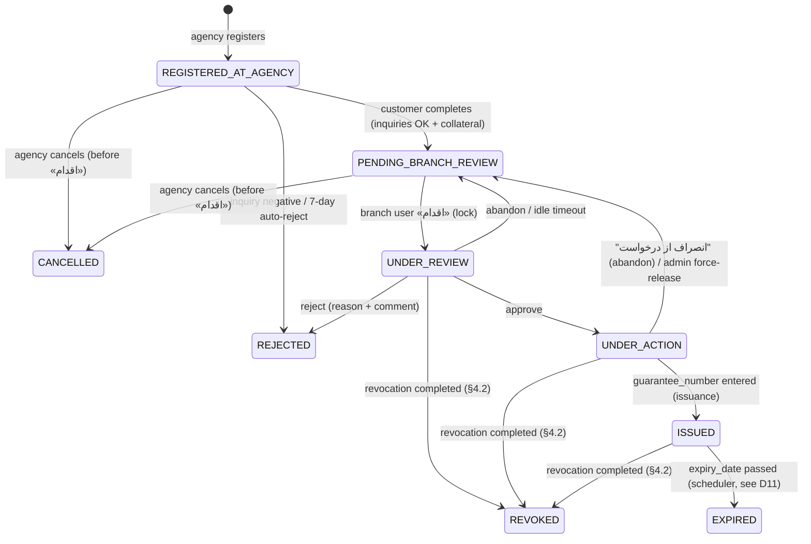
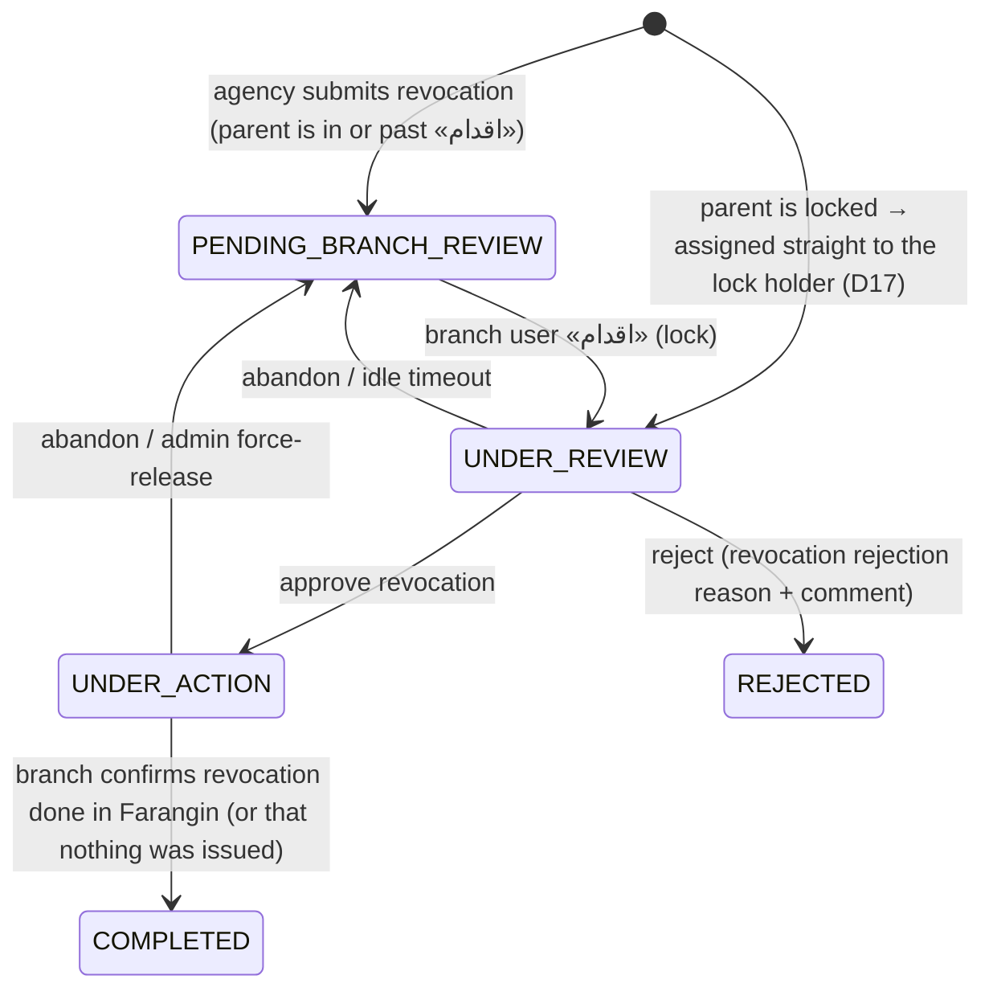

# AsanZeman (آسان ضمان) — Implementation Plan

> Sources:
> - *AsanZeman Architecture Document v1.0* (سند معماری سامانه آسان ضمان, 1405/08/07). Section references like **§3-3-4** point to this document.
> - *SRS-AZS v1.0* (1405/07/27). References look like **SRS: customer completion, step 13**.
>
> **Precedence:** where the two documents conflict, the **architecture document wins**. The SRS is used for business rules the architecture document doesn't spell out, such as the collateral formulas, eligible deposit types and screen behaviour.

---

## 1. What we are building

A system for a bank to process **travel-return guarantees** (ضمانتنامه بازگشت از سفر), from the agency's registration through branch approval to recording the guarantee number. Cancellation, revocation and reporting are included.

| Piece | Description |
|---|---|
| **Asan Zeman Core** | One Spring Boot **modular monolith** (Java 17) inside the bank intranet. It has 6 modules: Auth, Request, Inquiry, Notification, Report and Scheduler. |
| **Bank panel** | Angular SPA for branch users and admins (one app, role-based). Intranet only. Login: AAAService + ARcaptcha. |
| **Agency panel** | Angular SPA in the DMZ at `www.asanzeman.sb24.com/agencies`. Login: Yaghut `loginStatic` + ARcaptcha. |
| **Customer panel** | Angular SPA in the DMZ at `www.asanzeman.sb24.com`. Login: Yaghut `loginStatic` + ARcaptcha + SMS OTP. |
| **Oracle 19c+** | The **only** data store. There is no Redis, Kafka or object storage. Schemas: `AZS_AUTH`, `AZS_BUSINESS`, `AZS_INQUIRY`, `AZS_AUDIT`, `AZS_OUTBOX`. |
| **External** | **Called directly:** AAAService and Yaghut (4 services). **Called through the Bank API Gateway** (`apigw.int.sb24.com`, single token): the 9 inquiries, ARcaptcha and SMS Notifier. |
| **Out of scope (manual)** | Farangin (guarantee issuance and revocation) and the Digital Signature system. There is **no API integration** with either one. The branch user does this work by hand while the request is in `UNDER_ACTION`. |

### Core flows (§2-4)
1. **Issuance:** The agency registers the request. The customer completes it, which runs the 9 inquiries in parallel and covers collateral selection. The branch then locks the request and reviews it, and either approves (→ `UNDER_ACTION`) or rejects it. After approval, the branch signs and issues manually outside the system, then enters the guarantee number (→ `ISSUED`) and an SMS goes out.
2. **Cancellation or revocation by the agency.** What happens depends on how far the request has got (§4.2):
   - **Before «اقدام»** (`REGISTERED_AT_AGENCY` or `PENDING_BRANCH_REVIEW`): nothing has been done in the Digital Signature system or Farangin yet, so the request goes straight to **`CANCELLED` (لغو شده)**. No branch review is needed.
   - **From «اقدام» onward** (`UNDER_REVIEW`, `UNDER_ACTION` or `ISSUED`): something may already have been signed or issued, so a **revocation request (درخواست ابطال)** is sent to the branch. The branch reviews it, revokes manually in Farangin where needed, and confirms (→ **`REVOKED` (ابطال شده)**). The branch can also reject the revocation request.
3. **Agency tracking:** Filtered list of the agency's requests, with Excel export.
4. **Bank reporting:** Advanced filters with Excel export (SXSSF streaming).

---

## 2. Decisions to resolve before coding

The architecture document contradicts itself, or is silent, on the points below. Each open item lists a **proposed default**, so work can start, plus the person who needs to confirm it. Resolved items say how they were resolved.

| # | Issue | Where | Decision / proposed default | Owner |
|---|---|---|---|---|
| D1 | ✅ **Resolved: the lock can't span the manual work.** `SELECT … FOR UPDATE NOWAIT` only holds for one DB transaction, which means one HTTP call. Branch review, and especially `UNDER_ACTION`, lasts minutes to hours across many requests. | §3-4-3, §4-3-4, ADR-003; SRS: branch review, business rules | **Use a logical ownership lock, with `SELECT FOR UPDATE NOWAIT` guarding each change to it.** Full design in **§4.1**. ADR-003 is amended to match. | — |
| D2 | ✅ **Resolved: the mobile number is stored only as a hash, so SMS can't be sent to it.** The system has to send OTP and notification SMS to the customer's mobile, and a hash can't be used for that. | §6-3-1 vs §3-3-5; SRS: customer login, step 11 and business rules | **Never store the mobile number in plain text. Get it from Yaghut each time it's needed.** The SRS says the number registered in Farangin is the one to use, and Yaghut returns it from `loginStatic` and `getCustomerDetailInfo`. The database stores only `mobile_hash` (salted SHA-256) and `mobile_last2` for display (`01*******09`). Full design in **§6.1**. | — |
| D3 | **What happens when an inquiry fails.** §3-3-4 and §4-3-3 say a failure means *reject and stop*. The risk table (§11-1) says to *fall back to manual review*. | §3-3-4, §11-1 | A **negative** answer leads to reject. A **technical failure or timeout** marks the inquiry `FAILED` and blocks completion, and the customer may retry. Manual-review fallback is a later feature, controlled by a flag. | Business |
| D4 | **Inquiry timeout and retry values conflict.** One place says a flat 30 s with 3 retries. The per-service table says 8–15 s with 1–2 retries. | §4-3-3, §4-5, §7-6 vs §7-3 | Use the **per-service table (§7-3)** and put all values in config. The overall UC-09 budget is ≤ 25 s (P99, §9-1). | Architect |
| D5 | **Refresh-token lifetime** is given as 7 days in one place and 8 hours in another. | §3-3-2 vs §6-1-1 | Bank users get 8 h. Agency users get 8 h. Customers get no refresh token, or a short one. All values in config. | Security |
| D6 | ✅ **Resolved: the collateral formulas** were missing from the architecture document. | §3-3-3, §4-3-2; SRS: customer completion, step 13 and calculation table | Taken from the SRS. Full rules in **§4.3**. Three small follow-ups remain: D14–D16. | — |
| D7 | **Token transport.** The document asks for CSRF tokens and `SameSite=Strict` cookies, *and* JWT bearer tokens. | §6-2, §6-5 | Keep the access token in memory and send it as a `Authorization: Bearer` header. Put the refresh token in an `HttpOnly; Secure; SameSite=Strict` cookie, with CSRF protection on `/auth/refresh` only. | Security |
| D8 | **CI/CD platform.** The document says GitLab CI, but this repo is on GitHub. | §8-2 | Use **GitHub Actions** while the code lives here, and keep the pipeline stages the same so they port cleanly to GitLab. | Team |
| D9 | **Versions.** Spring Boot 3.2.x and Angular 17 are past upstream support. | §1-4 | Use the **current supported** Spring Boot 3.x line on Java 17 (or Java 21) and a current Angular LTS. Pin versions in the build. | Architect |
| D10 | **Runtime.** Kubernetes and standalone Tomcat are both left open. | §8-1 | Build a **Docker image** (executable jar). Tomcat/WAR is a fallback profile. | Ops |
| D11 | ✅ **Resolved: cancellation versus revocation.** | §5-2; SRS UC-11/12; product owner | **Before «اقدام»** the request goes to `CANCELLED` (لغو شده) immediately. **From «اقدام» onward** (including approved and issued requests), a revocation request goes to the branch, ending in `REVOKED` (ابطال شده). Full design in **§4.2**. *Still open:* whether `EXPIRED` is set by the scheduler when `expiry_date` passes (proposed: yes). | — |
| D17 | **Revocation requested while the branch user is partway through** (`UNDER_REVIEW` or `UNDER_ACTION`). | §4.2 | **The issuance flow stops.** Approve and reject are disabled, except for recording a guarantee number that was *already* issued in Farangin, so the records match reality. The revocation request goes **directly to the user who holds the lock**, because they know what was done in the Digital Signature system and Farangin. An admin can reassign it with force-release. | Business (confirm) |
| D12 | **Tracking code** is said to be 17 digits, but the scope of the "daily counter" isn't stated. | §5-3 | The counter is per (branch, agency, day). Keep it in a `tracking_counter` table that is incremented under a row lock. | Architect |
| D13 | **Secret storage.** Vault is mentioned for the JWT private key, but it isn't in the tech stack. | §6-2 | Confirm which secret store the bank has (Vault or KMS). Locally, use a key file mounted as a secret. | Ops |
| D14 | **The SRS pledge formula disagrees with its own worked example.** The formula reads `share% × 100% × (amount − cash)`. With 20 % cash and 80 % pledge on 1,000,000,000 rials that gives 640,000,000, but the example gives **800,000,000** (and 840,000,000 for expensive deposits). | SRS: calculation table | **Follow the worked example:** pledge = `(amount − cash) × factor`. Since cash % + pledge % = 100 %, this equals `pledge% × amount × factor`. | Business (confirm) |
| D15 | **A pledge that mixes cheap and expensive deposits.** The SRS allows several deposits from both groups in one pledge, but doesn't say how the remainder is split between them. | SRS: step 12 notes | Fill from **cheap deposits first** (×1.00), then expensive ones (×1.05, each capped at 95 % of its balance), in the order the customer selected them. | Business (confirm) |
| D16 | **Balances can change between completion and branch approval.** | SRS step 13; §6-3-1 (deposit data is never stored) | **Re-check balances through Yaghut `getDeposit` at approval.** If the deposits no longer cover the collateral, block approval and show the shortfall. | Business (confirm) |

---

## 3. Repository layout

```
asanzeman/
├── plan.md                      ← this file
├── docs/
│   ├── architecture/            ← source doc + diagrams, ADRs (one md per ADR)
│   └── api/openapi.yaml         ← API-first contract (§1-3)
├── backend/                     ← Spring Boot modular monolith (Maven)
│   └── src/main/java/com/sb24/asanzeman/
│       ├── AsanZemanApplication.java
│       ├── shared/              ← BaseEntity, errors, idempotency, audit, security utils
│       ├── auth/                ← api/ (public interfaces) + internal/
│       ├── request/             ← domain/, api/, internal/ (RequestService, CollateralService, LockService)
│       ├── inquiry/
│       ├── notification/
│       ├── report/
│       ├── scheduler/
│       └── integration/         ← AAAClient, YaghutClient, BankApiGatewayClient (+ mock impls)
│   └── src/main/resources/db/changelog/   ← Liquibase (§5-4)
├── frontend/                    ← Nx monorepo (ADR-007)
│   ├── apps/bank-panel/
│   ├── apps/agency-panel/
│   ├── apps/customer-panel/
│   └── libs/ (ui-rtl, auth, api-client generated from OpenAPI, shared models)
├── deploy/                      ← Dockerfiles, docker-compose (Oracle XE + mocks), k8s manifests
└── .github/workflows/           ← CI (see D8)
```

**Module boundaries:** use **Spring Modulith**, plus an ArchUnit test, so that cross-module calls can only go through each module's `api` package (ADR-001). This check runs in CI and fails the build when broken.

---

## 4. Domain model and state machine

### Entities (§5-1)
`Customer`, `Agency`, `Branch`, `Request`, `Companion` (≤ 5 per request), `Collateral`, `Inquiry`, `RejectionReason` and `AuditLog`. All of them extend `BaseEntity`, which has `id RAW(16)` (SYS_GUID), `created_at`, `updated_at`, `created_by` and `updated_by`.

Supporting tables: `otp_codes`, `refresh_tokens`, `jwt_blacklist`, `outbox_messages`, `scheduler_lock`, `idempotency_keys`, `tracking_counter`.

### Request lifecycle (§4-3-1, §7-5)

**Issuance request** (`request_type = ISSUANCE`):



**Revocation request** (`request_type = REVOCATION`, linked to its issuance request by `parent_request_id`). It goes through the same branch review and lock process as an issuance request:



| Status | Persian label | Meaning |
|---|---|---|
| `CANCELLED` | لغو شده | The agency withdrew the request **before «اقدام»**. Nothing was done outside the system. |
| `REVOKED` | ابطال شده | The issuance request was revoked through an approved and completed revocation request. |
| `PENDING_BRANCH_REVIEW` (on a revocation) | در انتظار بررسی درخواست ابطال ضمانتنامه | Waiting in the branch inbox (SRS UC-11, step 6) |

> **Naming.** The architecture document uses `CANCELLED` and `request_type = CANCELLATION` for ابطال. This plan separates **لغو (`CANCELLED`)** from **ابطال (`REVOKED`, `REVOCATION`)**, as the product owner asked. The meaning is unchanged; only the names differ.

- Transitions are implemented as methods on `Request`:
  - issuance: `complete()`, `cancelByAgency()`, `markIssued()`, `markRevoked()`
  - both request types: `lock()`, `approve()`, `reject()`, `abandon()`

  An illegal transition throws an `IllegalStateException`, which the API returns as **409**.
- Every transition publishes a Spring `ApplicationEvent` (`RequestRegistered`, `RequestCancelled`, `RevocationRequested`, `RequestApproved`, `RequestRejected`, `RequestRevoked`, `AutoRejectTriggered`, …). Notification and Audit subscribe to these events with `@TransactionalEventListener(AFTER_COMMIT)` (or `BEFORE_COMMIT` when writing to the outbox).

### 4.1 Request locking (resolves D1, amends ADR-003)

**The problem.** A database row lock from `SELECT … FOR UPDATE NOWAIT` is released at the end of its transaction, so it can't last longer than one HTTP request. The SRS says that once a branch user clicks **«اقدام»** (take action), the request is locked and disappears from every other user's inbox. It stays that way until the user finishes, or clicks **«انصراف از درخواست»** (abandon). That covers the whole `UNDER_REVIEW` and `UNDER_ACTION` period, including the manual digital-signature and Farangin steps, which can take hours.

**The design.** The lock is two layers working together:

1. **Ownership lock (lasts across requests).** It is stored as columns on `request`:
   - `locked_by` (RAW(16), the branch user), `locked_by_name` (for the inbox label), `locked_at` and `last_activity_at`
   - `version` (NUMBER, JPA `@Version`), as a second safeguard

   A request is locked whenever `locked_by IS NOT NULL`. The status says which phase it is in: `UNDER_REVIEW` or `UNDER_ACTION`.

2. **Row lock (lasts one transaction).** **Every** command that reads or changes ownership runs inside a single short transaction:
   ```
   BEGIN
     SELECT … FROM request WHERE id = :id FOR UPDATE NOWAIT   -- @Lock(PESSIMISTIC_WRITE) + lock.timeout=0
     -- ORA-00054 → 409 "این درخواست در حال اقدام توسط کاربر دیگری است" (another user is acting on this request)
     check branch scope, current status, and ownership
     apply the transition, write the audit row, publish the domain event
   COMMIT                                                     -- row lock released immediately
   ```
   This makes taking ownership atomic. Two users clicking «اقدام» at the same moment can't both win: one gets the row lock, and the other gets ORA-00054, which becomes a 409.

| Command | Allowed when | Effect |
|---|---|---|
| `POST /api/branch/requests/{id}/lock` («اقدام») | `PENDING_BRANCH_REVIEW` and request belongs to the user's branch, **or** the user already holds it (idempotent re-entry) | `UNDER_REVIEW`, sets `locked_by`, `locked_at` and `last_activity_at` |
| `approve` | `UNDER_REVIEW` and `locked_by = me` | `UNDER_ACTION`. **Ownership is kept** through the manual signing and Farangin steps |
| `reject` | `UNDER_REVIEW` and `locked_by = me` | `REJECTED`, clears the lock |
| `issue` (enter guarantee number) / `complete-revocation` | `UNDER_ACTION` and `locked_by = me` | Issuance request → `ISSUED`. Revocation request → `COMPLETED`, and its issuance request → `REVOKED`. Clears the lock. |
| `abandon` («انصراف از درخواست») | `UNDER_REVIEW` or `UNDER_ACTION`, and `locked_by = me` | `PENDING_BRANCH_REVIEW`, clears the lock |
| `force-release` (ADMIN only, reason required) | locked by anyone | `PENDING_BRANCH_REVIEW`, clears the lock, **audited** |
| any other mutating call while `locked_by ≠ me` | — | **409**, with the holder's name and the time it was locked |

- **Inbox (SRS):** locked requests are removed from other users' *action* lists but stay **visible read-only**, labelled "در حال بررسی / در حال اقدام — {name}". All branch users can still open the details.
- **Stale locks.** ADR-003 says the lock is freed if the user's session crashes, but an ownership lock doesn't free itself. So:
  - **`UNDER_REVIEW`:** a scheduler job releases locks idle longer than `azs.lock.review-idle-timeout` (default **60 min**, configurable) back to `PENDING_BRANCH_REVIEW`. This is audited as `AUTO_RELEASE`.
  - **`UNDER_ACTION`:** **never** released automatically, because the user may be partway through Farangin. It is freed only by the holder (abandon or complete) or by an admin force-release.
- **Every lock event is audited:** LOCK, ABANDON, AUTO_RELEASE and FORCE_RELEASE, with who did it, when, the IP and the reason.
- **Tests (Phase 4):** concurrent lock attempts (exactly one wins and the other gets 409); a non-owner trying approve, reject or issue (409); idempotent re-lock by the owner; auto-release of `UNDER_REVIEW` only; admin force-release; the lock surviving between HTTP calls.

### 4.2 Agency cancellation versus revocation (resolves D11)

**The rule (from the product owner).** Clicking «اقدام» is the dividing line:
- **Before «اقدام»**, the branch hasn't touched the Digital Signature system or Farangin, so the agency can simply **cancel (لغو)**.
- **From «اقدام» onward**, a contract may have been signed or a guarantee issued outside the system, so the branch must **revoke (ابطال)** it.

**One action, two outcomes.** The agency panel has a single «ثبت درخواست ابطال» (submit revocation request) action. The backend decides the outcome inside one transaction, under the row lock from §4.1:

```
BEGIN
  SELECT … FROM request WHERE id = :id FOR UPDATE NOWAIT     -- same guard as §4.1
  check agency ownership
  CASE status
    REGISTERED_AT_AGENCY, PENDING_BRANCH_REVIEW        → status = CANCELLED                       (لغو)
    UNDER_REVIEW, UNDER_ACTION, ISSUED                 → create REVOCATION request (parent_request_id)  (ابطال)
    REJECTED, CANCELLED, REVOKED, EXPIRED              → 409 (nothing to cancel)
    a revocation is already open                       → 409 (duplicate)
COMMIT
```

- **The confirmation message the agency sees depends on the status.** Before «اقدام», it says the request will be cancelled immediately. From «اقدام» onward, it uses the SRS text: «… پس از تایید، درخواست برای شعبه مربوطه ارسال خواهد شد» (after confirmation, the request will be sent to the branch). The API response also says which outcome happened (`CANCELLED` or `REVOCATION_REQUESTED`).
- **Race with the branch.** Suppose the agency clicks cancel at the same moment a branch user clicks «اقدام». The row lock lets only one of them go first. If the branch wins, the agency's call sees `UNDER_REVIEW` and creates a revocation request instead, which is the correct outcome. If the agency wins, the request is cancelled, and the branch user's «اقدام» gets a 409.
- **When the issuance request is mid-work (D17).** If it is in `UNDER_REVIEW` or `UNDER_ACTION`:
  - approve and reject on the issuance request are disabled
  - the holder may still record a guarantee number that was *already* issued in Farangin, so the records match reality
  - the new revocation request is assigned directly to that holder, with its status set to `UNDER_REVIEW` and its `locked_by` set to the holder
- **When revocation completes:** the issuance request moves to `REVOKED`, an audit row is written, and the customer and agency receive an SMS. If nothing had actually been issued in Farangin, the branch confirms that instead, and the issuance request still ends as `REVOKED`.
- **When revocation is rejected:** the revocation request becomes `REJECTED`, with a reason from the admin-managed list of revocation rejection reasons (SRS use case 6) and a comment. The issuance request is unchanged. If it was mid-work, its normal flow resumes.
- **Reports and tracking** show `CANCELLED` and `REVOKED` as separate statuses. Both the agency and the bank panels can filter on each.
- **Tests (Phase 5):**
  - every source status gives the correct outcome, as in the table above
  - the cancel-versus-«اقدام» race
  - a duplicate revocation returns 409
  - revocation of a request that is mid-work goes straight to the lock holder
  - a rejected revocation leaves the issuance request unchanged

### 4.3 Collateral calculation (resolves D6; source: SRS customer completion, steps 8–13 and the calculation table)

**Two kinds of collateral**
- **Cash (وجه نقد):** money is **withdrawn** from the customer's deposits.
- **Deposit pledge (توثیق سپرده):** money is **blocked** in the customer's deposits.

**Deposits shown to the customer** come from Yaghut `getDeposit`, filtered in the backend. A deposit is shown only if it is:
- held individually (انفرادی), not joint, with the customer as owner **and** signatory
- open and active, and not blocked for debit or credit (مسدود بدهکار/بستانکار)
- in rials. Foreign-currency deposits are never shown.

| Deposit type | Price class | Allowed for cash | Allowed for pledge |
|---|---|---|---|
| Short-term normal (کوتاه‌مدت عادی) | Cheap | ✅ | ✅ |
| Short-term Win (کوتاه‌مدت وین) | Cheap | ✅ | ✅ |
| Qard-al-Hasan savings (قرض‌الحسنه پس‌انداز) | Cheap | ✅ | ✅ |
| Qard-al-Hasan savings Win (قرض‌الحسنه پس‌انداز وین) | Cheap | ✅ | ✅ |
| Qard-al-Hasan current (قرض‌الحسنه جاری) | Cheap | ✅ | ✅ |
| Long-term (بلندمدت) | Expensive | ❌ | ✅ (block ≤ 95 % of balance) |
| Short-term special (کوتاه‌مدت ویژه) | Expensive | ❌ | ✅ (block ≤ 95 % of balance) |

> The SRS table row for cash lists fewer types than its own deposit-filter rules. This plan follows the **filter rules**, which give the full list above. The mapping from Yaghut deposit type codes to price class goes in a reference table, so it can change without a release.

**Share percentages (SRS step 12)**
- Cash share `c`: 20 % to 100 %, in steps of 10. **At least 20 % cash is mandatory.**
- Pledge share `p`: 0 %, or 10 % to 80 %, in steps of 10.
- `c + p = 100 %`. If `c = 100 %`, the pledge options are disabled.
- A deposit can be marked for cash, pledge or both, and more than one deposit can be selected.

**Formulas.** `A` is the guarantee amount in rials.

| Part | Amount | Rule that must hold |
|---|---|---|
| Cash | `C = c × A` | Σ withdrawable balance of the deposits selected for cash ≥ `C` |
| Pledge base | `R = A − C` (= `p × A`) | — |
| Pledge on cheap deposits | `R_cheap × 1.00` | Σ withdrawable balance of the selected cheap deposits ≥ the amount blocked on them |
| Pledge on expensive deposits | `R_exp × 1.05` | For **each** expensive deposit, the amount blocked ≤ **95 %** of its withdrawable balance. If not, show an error and ask the customer to pick another option. |
| **Total collateral** | `C + R_cheap × 1.00 + R_exp × 1.05` | `R_cheap + R_exp = R`, split per D15 |

- When one deposit is used for both cash and pledge, the cash withdrawn plus the amount blocked must fit within that deposit's withdrawable balance.
- **Rounding:** use `BigDecimal` and round to whole rials with `CEILING`, so the bank is never under-collateralised. *Confirm this with the business.*
- **Insufficient balance (SRS sub-flow 11):** show «مشتری گرامی! به دلیل کافی‌نبودن موجودی در سپرده‌های انتخابی برای وثیقه، ثبت درخواست امکان‌پذیر نیست…» (insufficient balance in the selected deposits). The request cannot be submitted.
- **UI:** show a green tick next to each deposit row once the selection covers the required amount. When cash alone is enough at 100 %, the other rows are disabled.

**Worked examples.** These become unit tests. `A = 1,000,000,000` rials.

| Case | Cash | Pledge | Total collateral | Notes |
|---|---|---|---|---|
| 100 % cash | 1,000,000,000 | 0 | 1,000,000,000 | pledge rows disabled |
| 20 % cash, 80 % cheap pledge | 200,000,000 | 800,000,000 | 1,000,000,000 | SRS example (see D14) |
| 20 % cash, 80 % expensive pledge | 200,000,000 | 840,000,000 | 1,040,000,000 | SRS example; that deposit's balance must be ≥ 884,210,527 (840M ÷ 0.95, rounded up) |
| 50 % cash, 50 % expensive pledge | 500,000,000 | 525,000,000 | 1,025,000,000 | |
| 10 % cash | — | — | — | rejected, below the 20 % minimum |
| 20 % cash, 70 % pledge | — | — | — | rejected, shares must add up to 100 % |

**Implementation.** `CollateralService` uses the Strategy pattern from §4-3-2, with these strategies:
- `CashStrategy`
- `CheapPledgeStrategy` (factor 1.00)
- `ExpensivePledgeStrategy` (factor 1.05, cap 0.95)

Each strategy is an immutable value class. The factors, the cap and the share ranges live in configuration.

**What gets saved:** one `Collateral` row per deposit allocation, with:
- deposit number and type, price class, collateral type (CASH or PLEDGE)
- share %, factor, allocated amount and calculated collateral

**Balances are never saved** (§6-3-1). They are fetched again at branch approval (D16).

---

## 5. Integration plan (§4-5, §7)

| Client | Target | Notes |
|---|---|---|
| `AAAClient` | AAAService (direct HTTPS) | Login for branch/admin users. Returns the user and their role (`ROLE_BRANCH` or `ROLE_ADMIN`) and the branch code. |
| `YaghutClient` | Yaghut (direct HTTPS) | Four calls: `loginStatic`, `getBranch`, `getDeposit` and `getCustomerDetailInfo`. Deposit data is **never stored**. |
| `BankApiGatewayClient` | `apigw.int.sb24.com` | One token for everything: the 9 inquiries, ARcaptcha and Notifier (`SendOTP`, `SendSimpleSms`). |

- **Anti-corruption layer:** each external service gets its own adapter that maps its format to domain types.
- **Resilience4j** (§7-6): circuit breaker opens at 50 % failures over a 20-call window and stays open 30 s. Retry ×3 with 1 s, 2 s, 4 s backoff, on 5xx and timeouts only. Bulkhead of 20. Rate limiter of 10 req/s. Timeouts per D4.
- Every call sends an `Idempotency-Key` header and the correlation/trace ID.
- **Mock implementations** of every client go under the `mock` Spring profile, with configurable scenarios (success, negative, timeout, 5xx). These are what unblock development before the bank gives us access to its services.
- **UC-09 inquiries:** run with `CompletableFuture` on a dedicated bounded executor. Sepad is only called for men aged 18–50. Results are saved to `inquiries` with the raw response. The step fails fast on the first negative answer, which cancels the remaining futures.

---

## 6. Security plan (§6)

- **JWT:** RS256. 15-minute access token. Claims: `sub`, `role`, `branch_code` / `agency_id`, `iat` and `exp`. Revocation through `jwt_blacklist`.
- **Authorization:** `@PreAuthorize` on every endpoint. Roles are `BRANCH`, `ADMIN`, `AGENCY` and `CUSTOMER`. Every query is also scoped by ownership: an agency only sees its own requests, a branch only its own branch, and a customer only their own requests.
- **OTP:** 6 digits with a 120 s TTL, stored hashed in `otp_codes`. 3 wrong attempts trigger a 15-minute lockout. After OTP succeeds, the national code returned by Yaghut must match the request's customer.
- **Data protection:** encryption at rest via TDE, provided by the DBA. National codes are masked in logs. Mobile numbers are handled as in §6.1. TLS 1.2+ with HSTS.
- **Audit:** an append-only `audit_log` table in `AZS_AUDIT`, partitioned monthly and kept 7 years. The app's DB user has `INSERT`-only grants on it. It is written for every state change and every admin edit, with old/new JSON, IP and user agent.
- **Abuse protection:** a rate-limit filter allows 100 requests/min per client IP, read from the proxy's `X-Forwarded-For` header. Login pages use ARcaptcha. CSP headers are set and Angular's auto-escaping is relied on.
- **Idempotency:** every POST/PUT requires an `Idempotency-Key`. Keys and their stored responses are kept in `idempotency_keys` for 24 h.

### 6.1 Customer mobile number (resolves D2)

**Rule:** the plain mobile number **never reaches the database**: not in tables, the outbox, the audit log or application logs. The number to use is the one registered in Farangin (SRS), and Yaghut provides it.

| Where it is needed | Where it comes from |
|---|---|
| Sending the login OTP | The `loginStatic` response for that login. Held in memory only for that one call. |
| Shahkar inquiry (UC-09) | `getCustomerDetailInfo`, fetched just before the inquiries run. In memory only. |
| Notification SMS (issued, rejected, cancelled, revoked, auto-rejected) | Looked up **when the message is sent**. The outbox row stores `recipient_ref` (customer number or national code), not the number. The dispatcher calls `getCustomerDetailInfo` and then the Notifier. |
| Masked display ("…to 01\*\*\*\*\*\*\*09") | `customer.mobile_last2` |
| Noticing that the customer's number has changed | `customer.mobile_hash` (salted SHA-256, with the salt kept in the secret store) compared with the hash of Yaghut's latest answer |

**OTP stays fast and still uses the outbox**, as the architecture document requires:
- The OTP is written to the outbox with priority `HIGH`.
- The dispatcher is woken immediately after commit by an `AFTER_COMMIT` event, so it doesn't wait for the next polling cycle.
- The OTP has a short TTL, so it is never retried after it expires.

**If Yaghut is down when a notification is due,** the outbox row stays pending and is retried with backoff (Phase 6). Nothing is lost, and the number is still never stored.

**Logging:** the mobile number is never logged. Any field named `mobile` is masked by the JSON log encoder.

---

## 7. Delivery phases

Each phase ends with a demoable result and its own exit criteria. External services are mocked until the bank grants access.

### Phase 0 — Foundation
- Repo skeleton (layout in §3), Maven backend and Nx frontend.
- `docker-compose` with Oracle XE (gvenzl/oracle-xe) and mock external services.
- Liquibase baseline: the 5 schemas, `BaseEntity` columns and the reference tables (`branch`, `agency`, `rejection_reason`).
- Cross-cutting pieces: error model (RFC 7807), correlation ID filter, structured JSON logging, Actuator/Micrometer, OpenTelemetry, idempotency filter, audit writer, Spring Modulith/ArchUnit boundary test.
- CI: build → unit tests (JaCoCo ≥ 80 %) → integration tests (Testcontainers Oracle) → SonarQube/OWASP Dependency-Check → Trivy image scan.
- First draft of `docs/api/openapi.yaml`.

**Exit:** `docker compose up` gives a running core plus Oracle, CI is green, and the health endpoint responds.

### Phase 1 — Auth module
- Bank login: ARcaptcha → AAAService → JWT with the user's role.
- Agency login: ARcaptcha → Yaghut `loginStatic` → agency profile → JWT.
- Customer login: ARcaptcha → `loginStatic` → OTP via Notifier → verify → JWT.
- Refresh, logout and blacklist. OTP table with attempt limits and lockout.
- Angular: shared `auth` library, a login screen per app, HTTP interceptor and route guards, RTL layout.

**Exit:** all three panels can log in against the mocks. The OTP brute-force limits are covered by tests.

### Phase 2 — Request registration (agency side)
- Agency registers an issuance request: customer lookup (`getCustomerDetailInfo`), branch selection (`getBranch`), amount, expiry and companions (≤ 5).
- Tracking-code generator (D12) and the `Request` aggregate with the state machine and domain events.
- SMS notifying the customer, through the outbox (pulled forward from Phase 6 in its minimal form).

**Exit:** a request created in the agency panel shows up in the customer panel.

### Phase 3 — Customer completion: inquiries and collateral (UC-09)
- InquiryService runs the 9 inquiries in parallel, with the per-service timeouts and retries (D4) and persists each result.
- Filter eligible deposits from `getDeposit` (individual, owner and signatory, active, rial) and classify them as cheap or expensive (§4.3).
- CollateralService: Cash, cheap-pledge and expensive-pledge strategies (§4.3). The SRS worked examples become unit tests. Confirm D14 and D15 with the business before closing this phase.
- `start-completion` and `complete` endpoints. Customer panel steps: review the request → inquiries → choose collateral → submit.

**Exit:** the full completion flow works with the mocks, and the UC-09 P95 is ≤ 15 s with injected latency.

### Phase 4 — Branch review and manual issuance
- Branch inbox (`status, branch_id` index), scoped to the user's branch and its contracted agencies (SRS).
- Ownership lock as designed in §4.1: «اقدام», approve, reject, abandon, admin force-release, and the idle auto-release job for `UNDER_REVIEW`.
- Re-check balances at approval (D16).
- `UNDER_ACTION` screen: checklist for the manual steps (digital signature, then Farangin), guarantee-number entry with format validation, and «انصراف از درخواست».
- Inbox shows locked requests read-only, with the holder's name.

**Exit:** all the §4.1 lock tests pass, including concurrent «اقدام» clicks where exactly one wins. The full issuance path reaches `ISSUED` with an SMS sent.

### Phase 5 — Cancellation and revocation (§4.2)
- One agency action, with the backend choosing the outcome under the row lock:
  - **before «اقدام»** → `CANCELLED` (لغو) immediately
  - **from «اقدام» onward** → a revocation request (ابطال)
- Revocation request flow: branch inbox → «اقدام» → approve or reject (using the revocation rejection reasons) → `UNDER_ACTION` → manual revocation in Farangin → confirm. The issuance request becomes `REVOKED`.
- Revocation of a request that is mid-work goes straight to the lock holder (D17).
- Agency confirmation message chosen by status. SMS notifications. `CANCELLED` and `REVOKED` both appear in tracking and reports.

**Exit:** every test listed in §4.2 passes, and every step is recorded in the audit log.

### Phase 6 — Notification module (complete)
- Outbox worker with priorities (OTP first), retries with backoff and dead-lettering. Templates for issued, rejected, cancelled, revoked and auto-rejected messages, using the SRS wording.
- The recipient's number is looked up through Yaghut when each message is sent (§6.1). The outbox never stores a mobile number.

**Exit:** with the SMS mock down for 5 minutes, no messages are lost and all of them are delivered after it recovers.

### Phase 7 — Tracking and reporting
- Agency tracking: filters, pagination and Excel export.
- Bank reports: advanced filters and SXSSF streaming export. Reports use a read-only datasource that can point at the Data Guard standby.
- Admin: CRUD for agencies, rejection reasons and other reference data, with a Caffeine cache that is invalidated on writes.

**Exit:** a 100k-row export runs in bounded memory. A 1,000-row export meets P95 ≤ 10 s.

### Phase 8 — Scheduler
- Leader election through `scheduler_lock`, shedlock style.
- Jobs: auto-reject requests left incomplete after 7 days, release idle `UNDER_REVIEW` locks (§4.1), purge expired OTPs and blacklist entries, set `EXPIRED` (D11), and maintain partitions.

**Exit:** with 2 instances running, each job runs exactly once.

### Phase 9 — Hardening and performance
- Load tests (k6 or Gatling) against the SLAs in §9-1. HikariCP tuning, checks on the Oracle execution plans, and Bitmap and partitioning decisions.
- Security review: OWASP ASVS checklist, penetration test findings, CSP and HSTS verification.
- Grafana dashboards: requests per state, UC-09 duration and OTPs sent.

**Exit:** all SLAs met in UAT-like conditions and no high or critical findings remain.

### Phase 10 — Deployment and go-live
- Images, Kubernetes manifests (or Tomcat profile), and a rolling or blue-green release.
- Liquibase migrations go through DBA review for production. Backup and DR runbook (RTO 2 h, RPO 15 min). Training material for branch users on the manual steps.

**Exit:** production deployment checklist signed off.

---

## 8. Testing strategy

| Level | Tools | Focus |
|---|---|---|
| Unit | JUnit 5, AssertJ, Mockito | State machine transitions, collateral strategies, tracking code generation, OTP rules |
| Module | Spring Modulith `@ApplicationModuleTest` | Each module tested on its own, events published and consumed |
| Integration | Testcontainers (Oracle XE), WireMock | Repositories, `SELECT FOR UPDATE NOWAIT` → 409, Liquibase, external client resilience |
| Contract | OpenAPI validation in CI | Backend matches `openapi.yaml`, generated Angular client compiles |
| Architecture | ArchUnit / Modulith verify | Module boundaries, layering (no business logic in controllers) |
| E2E | Playwright | Main path for each panel: issuance, cancellation before «اقدام», revocation, tracking, report |
| Performance | k6 or Gatling | SLA table in §9-1 |
| Security | OWASP ZAP, Dependency-Check, Trivy | Pipeline gates |

---

## 9. Definition of done (per feature)
- The OpenAPI contract is updated first, then implemented.
- Unit and integration tests are written, coverage is ≥ 80 % on changed code, and the module-boundary test passes.
- State changes are audited, and POST/PUT endpoints are idempotent.
- Metrics and logs are added. Logs contain no PII (national code masked, no mobile number).
- The Liquibase changeset has a rollback block.
- Persian/RTL UI has been reviewed in all affected panels.

---

## 10. Immediate next steps
1. D1, D2, D6 and D11 are resolved. Confirm the remaining open items with their owners, mainly **D3** (inquiry failure handling), **D14–D16** (collateral details), **D17** (revocation of a request that is mid-work) and the rounding rule in §4.3.
2. Get the API specs for Yaghut (including the deposit type codes), AAAService and the Bank API Gateway, so the mocks match the real services.
3. Write ADR-008 in `docs/architecture/`, recording the amendment to ADR-003 (the ownership lock in §4.1).
4. Start **Phase 0** in this repository.
